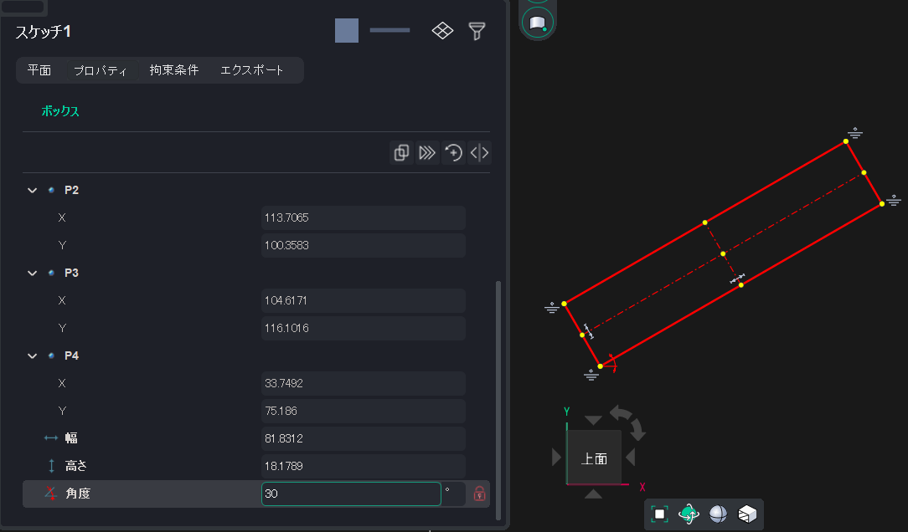
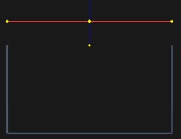

# Edição de retângulo

O objeto retângulo selecionado pode ser modificado na janela gráfica ou você pode alterar seus parâmetros no inspetor.

Ao editar um retângulo, todos esses parâmetros podem ser fixados clicando no símbolo de "cadeado" no inspetor ou no ícone apropriado no próprio retângulo.

Ao editar um retângulo movendo seus pontos, você pode usar a ajuda de linhas-guia. Por padrão, as guias são oferecidas a partir do ponto que está sendo editado e do ponto oposto em ângulos de 0°, 45°, 90° e ao longo de uma linha reta que passa por esses pontos.

Você pode selecionar uma linha que faça parte de um retângulo mantendo pressionada a tecla <strong>[Ctrl]</strong> enquanto clica nessa linha na janela gráfica. Se você "arrancar" a linha do retângulo, o retângulo será dividido em linhas.

