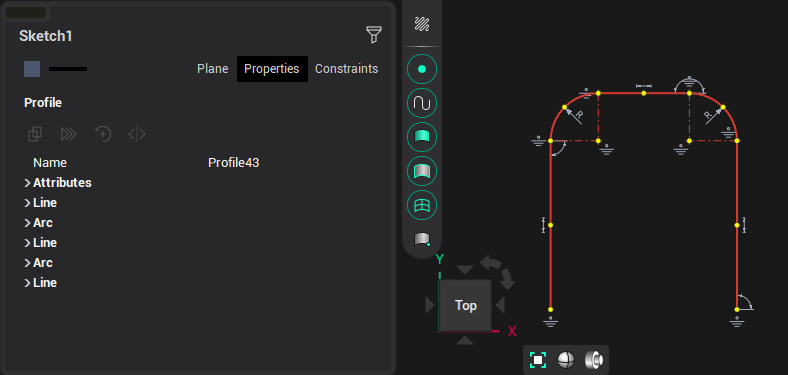
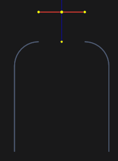

# Edição de contorno

O contorno selecionado pode ser modificado alterando seus pontos na janela gráfica. É possível alterar as propriedades dos elementos de contorno no inspetor.

No modo de edição, o contorno será apresentado como um conjunto de linhas e arcos.

Se você selecionar o lado do contorno pressionando **Ctrl**, somente o elemento de contorno realçado será selecionado. Se você separar um elemento de um contorno, o contorno será dividido em elementos.

