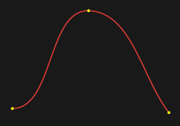

# Spline

Spline is a piecewise curve interpolation with lines. Spline passes through given points and is tangential to given start and end angles.

It is possible to input spline points directly in the graphic window. Otherwise the left inspector can be used to input number of points and point coordinates.

Click  or double-click at last point to finish spline.

**Number of points.** The number of defining points.

**Spline points.** Coordinates of the defining points.

**Spline precision.** Maximum deviation of the polyline approximation from the curve; 0.1 by default.

**First point tangential**, **Last point tangential**. Tangent angles at the endpoints.

**End spline** finishes construction from three points onward. Double-clicking or **[Enter]** also finishes it. Clicking the first point closes the spline.
