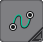
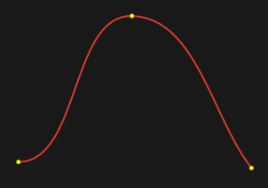
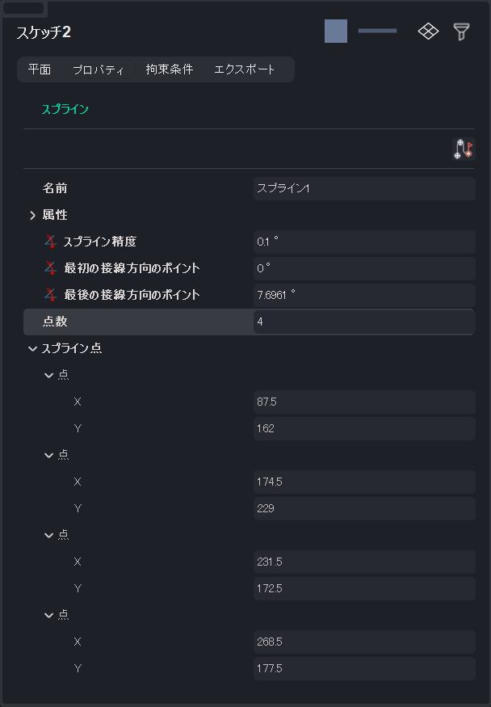

# Spline

La spline è un'interpolazione di curva a tratti con segmenti di retta. La spline passa per i punti dati ed è tangente agli angoli iniziale e finale assegnati.

È possibile inserire i punti della spline direttamente nella finestra grafica. In alternativa si può usare l'inspector di sinistra per inserire il numero di punti e le coordinate dei punti.

Fare clic su  oppure fare doppio clic sull'ultimo punto per terminare la spline.
