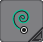
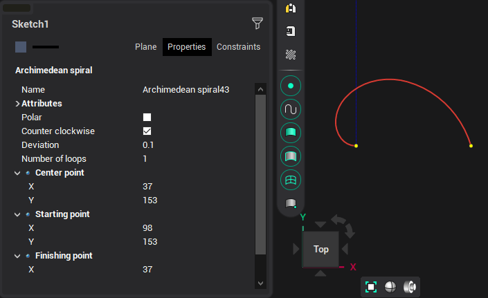

# Spirale di Archimede

Crea una curva di Archimede definendo il punto centrale, il punto iniziale e il punto finale. È possibile impostare i punti in modo interattivo oppure fornire le coordinate nel pannello Inspector (ispettore).

