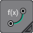
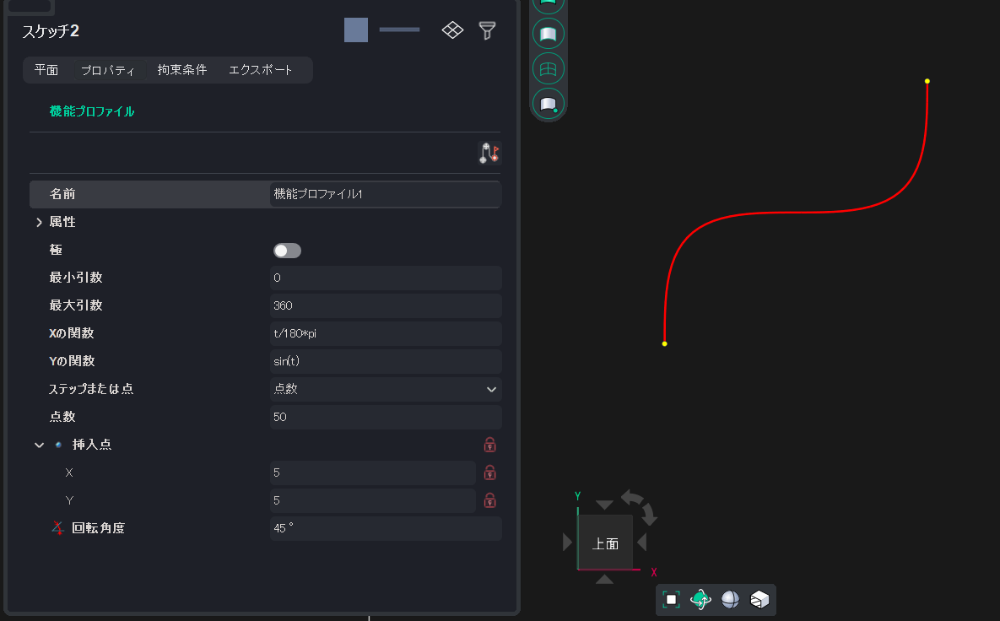
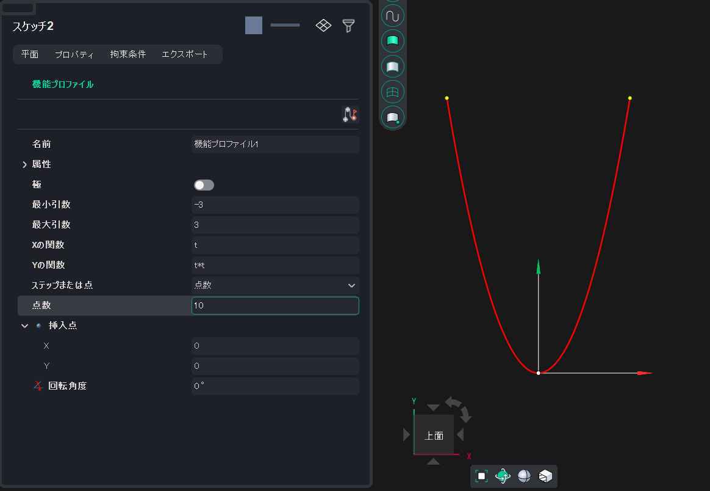

# Perfil definido por função

Cria uma curva que passa por pontos cujas coordenadas são calculadas pela expressão fornecida pelo usuário.

Os pontos são calculados substituindo <strong>t</strong> por valores de <strong>Argument minimum</strong> a <strong>maximum</strong> nas expressões de <strong>X</strong> e <strong>Y</strong>. É possível definir o ponto de inserção da curva e adicionar rotação em torno desse ponto.

Clique no botão  ou clique na janela gráfica para concluir a definição da curva.

As expressões reconhecem as funções matemáticas comuns:

- sin(t) - seno de <strong>t</strong>
- cos(t) - cosseno de <strong>t</strong>
- tan(t) - tangente de <strong>t</strong>
- cotan(t) - cotangente de <strong>t</strong>
- arctan(t) - arco tangente de <strong>t</strong>

Nas funções trigonométricas, o argumento é expresso em radianos. <strong>Pi</strong> é o número <strong>π</strong>.

- exp(t) - <strong>e</strong> elevado à potência <strong>t</strong>
- ln(t) - logaritmo natural de <strong>t</strong>
- sqrt - raiz quadrada de <strong>t</strong>

## Exemplos de perfis de função

### Função quadrática (parábola): Y = X2

### Exponencial: Y = 10x
