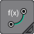
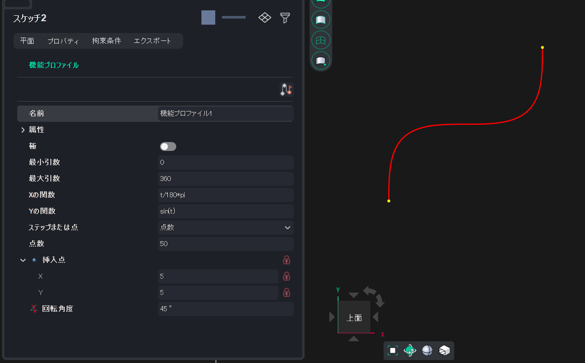
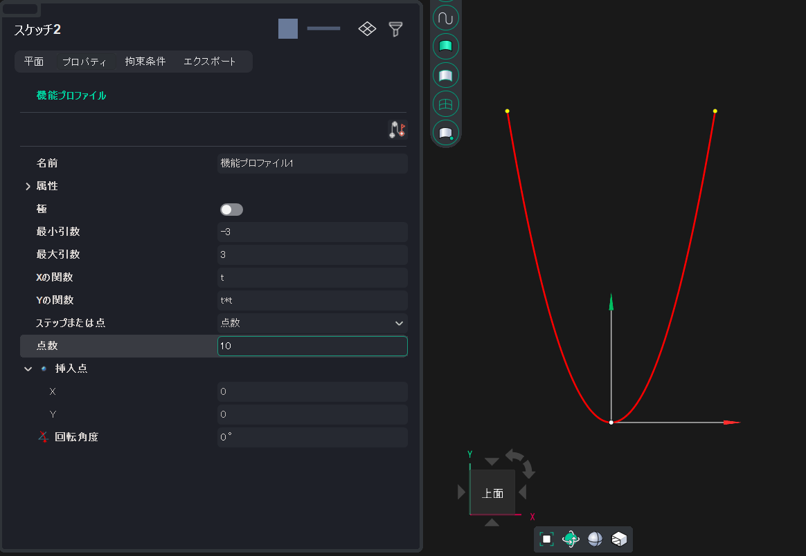

# Function profile

Create curve that passes through points whose coordinates are calculated by expression provided by user.

Points are calculated by substituting **t** with values from **Argument minimum** to **maximum** into expressions for **X** and **Y**. It is possible to set curve insertion point and add rotation around that point.

Click the  button or click in the graphic window to finish curve definition.

Expressions recognizes common mathematical functions:

- sin(t) - sine of **t**
- cos(t) - cosine of **t**
- tan(t) - tangent of **t**
- arctan(t) - arc-tangent of **t**

For trigonometrical functions the argument is in radians. **Pi** is the **π** number.

- exp(t) - **e** raised to the power of **t**
- ln(t) - natural logarithm of **t**
- sqrt - square root of **t**

## Examples of function profiles

### Quadratic function (parabola): Y = t^2

### Exponential: Y = 10^t

## Expressions and parameters

The argument is `t`, angles are in radians and the constant is `PI`. Spaces are not allowed. Supported functions include `SIN COS TG TAN ASIN ACOS ATG ARCTAN SINH COSH EXP LN SQRT ABS SGN SIGN HEAV MAX(a,b) MIN(a,b)`; operators are `+ - * / ^ MOD DIV`.

**Argument minimum**, **Argument maximum**. Default to 0 and 360.

**Function for X**, **Function for Y**. Coordinate expressions. For a parabola, enter `t` for X and `t^2` for Y; for the exponential example, enter `t` for X and `10^t` for Y.

**Polar.** Uses **Function for R** and **Function for A** instead of X and Y.

**Steps or points.** Selects the discretization method.

**Number of steps.** Defaults to 360.

**Number of points.** The point count for the corresponding discretization method.

**Insertion point**, **Rotation angle**. Position the result.

The result is a polyline with the specified number of segments. **Done** completes construction.
