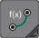
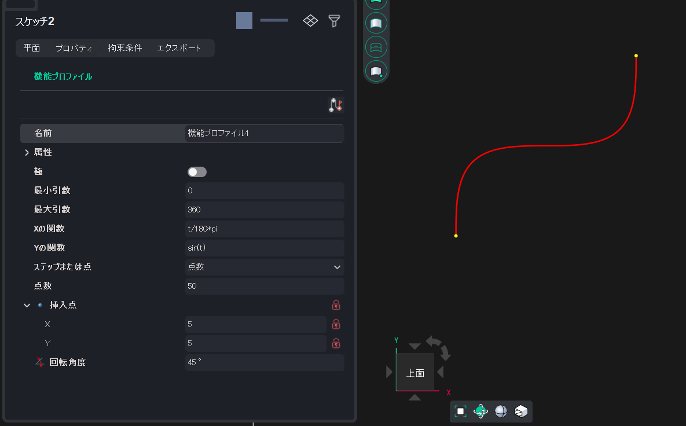
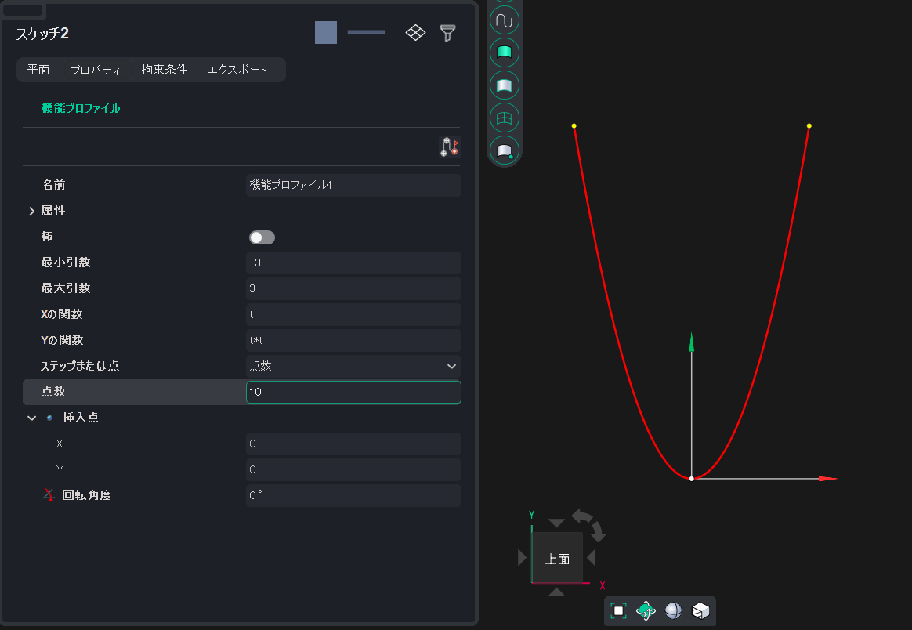

# Function profile

Create curve that passes through points whose coordinates are calculated by expression provided by user.

Points are calculated by substituting **t** with values from **Argument minimum** to **maximum** into expressions for **X** and **Y**. It is possible to set curve insertion point and add rotation around that point.

Click the  button or click in the graphic window to finish curve definition.

Expressions recognizes common mathematical functions:

- sin(t) - sine of **t**
- cos(t) - cosine of **t**
- tan(t) - tangent of **t**
- cotan(t) - cotangent of **t**
- arctan(t) - arc-tangent of **t**

For trigonometrical functions the argument is in radians. **Pi** is the **π** number.

- exp(t) - **e** raised to the power of **t**
- ln(t) - natural logarithm of **t**
- sqrt - square root of **t**

## Examples of function profiles

### Quadratic function (parabola): Y = X2

### Exponential: Y = 10x

###
