# Soldagem por pontos

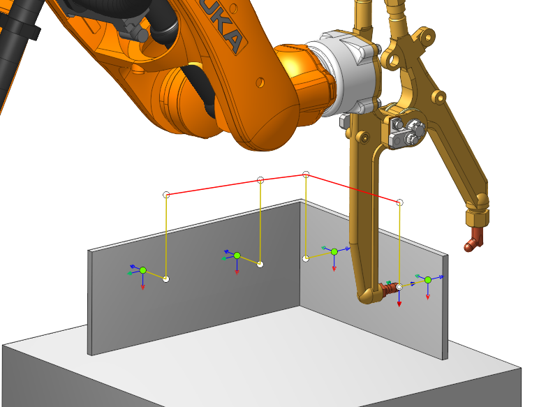

A operação pode ser usada para 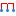 <strong>Tack weld</strong> (solda de fixação) e 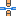 <strong>Spot weld</strong> (solda a ponto).

#### Definição da tarefa

Na guia de estratégia, selecione o tipo de soldagem:  Tack weld

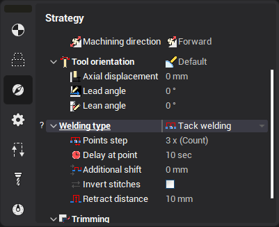

 Spot weld

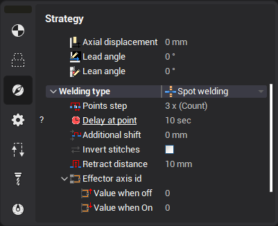

Para ambos os tipos, a definição da tarefa é a mesma.

A <strong>definição da tarefa 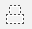</strong> consiste em dois tipos de pontos:

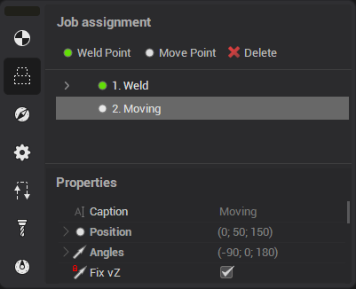

 Weld Point (ponto de solda)  Move Point (ponto de movimentação)

Esses pontos podem ser usados para construir uma cadeia de trajetórias:

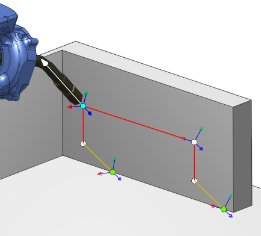

<strong>Arrastar pontos</strong>

Esses pontos podem ser movidos arrastando-os.

Eles se fixam a faces 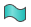, curvas 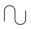, splines , arestas 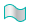 e vértices 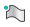. Ao se fixar, o eixo da ferramenta gira automaticamente.

Os <strong>Move points</strong> podem ser movidos facilmente com o <strong>Smart snap 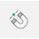</strong>:

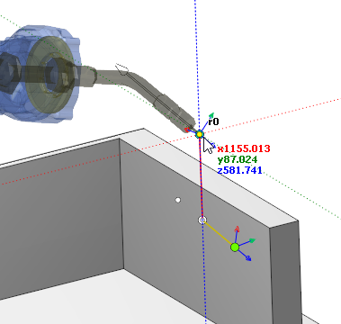

A posição do ponto também pode ser especificada como um deslocamento em relação ao ponto auxiliar amarelo.

Para fazer isso, primeiro selecione o ponto amarelo:

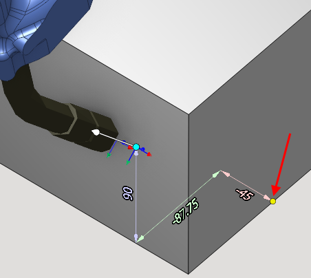

Você também pode girar o vetor do eixo arrastando o vetor visual:

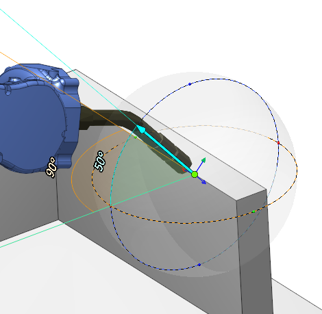

<strong>Parâmetros de ponto</strong>

Os pontos contêm os seguintes parâmetros:

 Weld Point (ponto de solda)

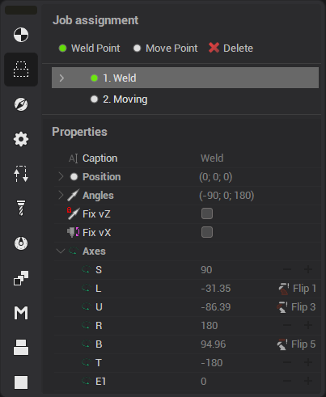

 Move Point (ponto de movimentação)

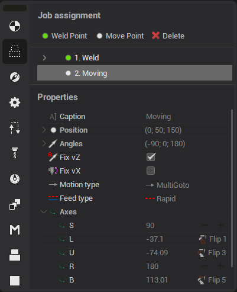

 Caption - nome do ponto

 Position - coordenadas do ponto.

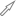 Angles - ângulo de inclinação do eixo da ferramenta no ponto

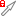 Fix vZ - se ativado, o vetor do ponto não muda ao ser arrastado

 Fix vX - ativa o modo de edição de 6 eixos:

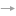 Motion type - define o tipo de movimento até o ponto: MultiGoto - movimento multicoordenado  PhysicGoto - movimento dos eixos físicos da máquina  Avoid collisions - movimento com prevenção de colisões

 Axes - eixos da máquina no ponto atual.

Ao alterar os eixos, dois botões são exibidos:

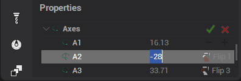

-  - move o ponto para a ponta da máquina

-  - restaura os valores anteriores

- 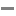  - 360/+360

 Flip - controla os flips do robô

<strong>Ponto auxiliar</strong>

 O ponto de solda também contém pontos auxiliares adicionais: Clearence, Engage, Retract

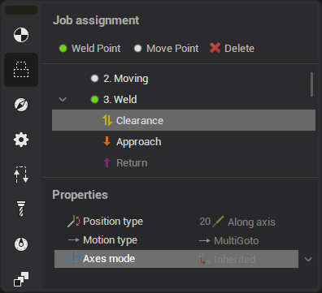

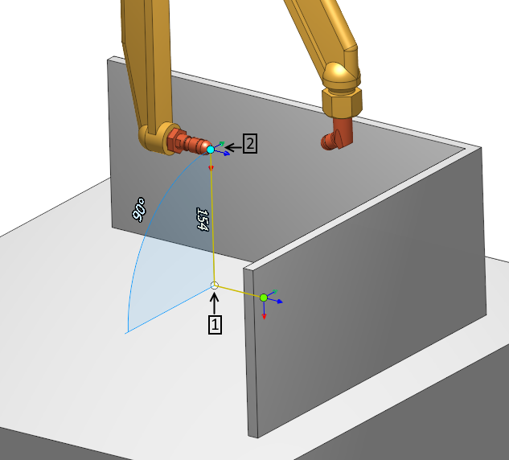
