# ポイント溶接

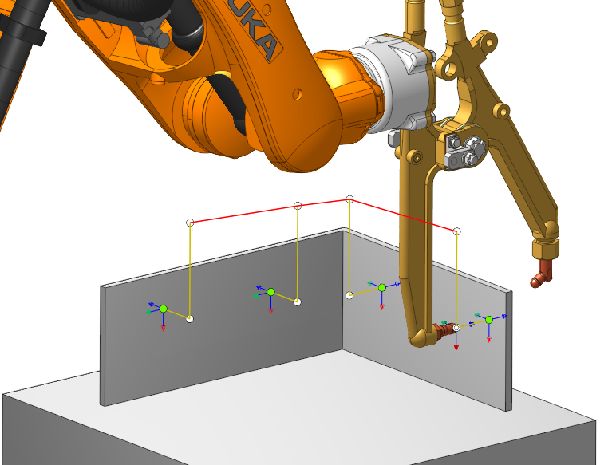

このオペレーションは、 <strong>タック溶接</strong>と  <strong>スポット溶接</strong>に使用できます。

#### ジョブ割り当て：

加工設定では、溶接の種類を選択する必要があります。  タック溶接 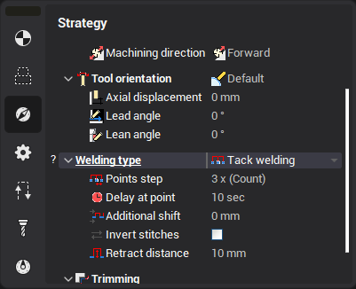  スポット溶接 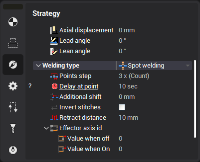

両方の溶接タイプにおいて、ジョブ割り当ては同じです。

<strong>ジョブ割り当て 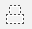</strong> は以下の2種類で構成されます。

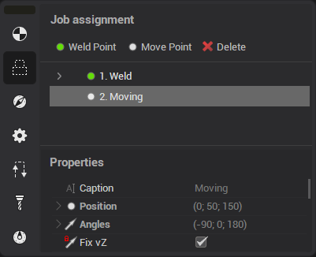  溶接ポイント  移動ポイント

これらのポイントを用いて、一連の軌跡のチェーンを構成することができます。

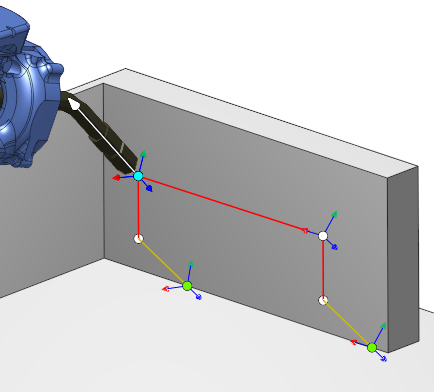

<strong>ドラッグポイント</strong>

これらの点はドラッグで移動できます。

これらは、フェイス  、カーブ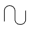 、スプライン 、エッジ 、頂点 に付着します。工具軸を取り付けると自動的に回転します。

<strong>移動ポイント</strong> は、 <strong>スマートスナップ 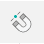</strong> を使用して簡単に移動できます。

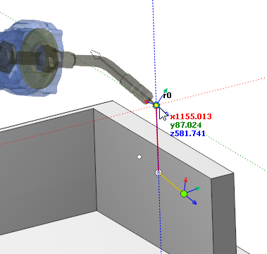

点の位置は、補助の黄色点からのオフセットとして指定することもできます。

これを行うには、まず黄色の点を選択します。

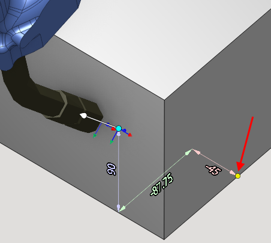

ビジュアルベクトルをドラッグして軸ベクトルを回転させることもできます。

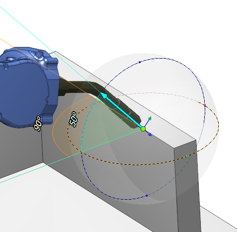

<strong>点パラメーター</strong>

点には以下のパラメータが含まれます。

 溶接ポイント

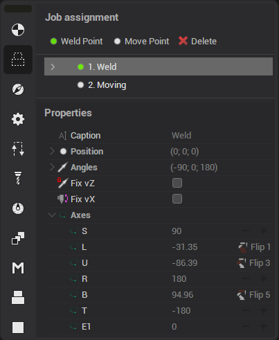

 移動ポイント

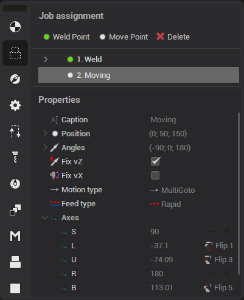

 説明 - ポイント名

 位置 - 点座標

 角度 - 点における工具軸の傾斜角度

 Fix vZ - 有効化されている場合、点ベクトルがドラッグされたときに変化しない

 Fix vX - 6軸編集モードを有効にします：

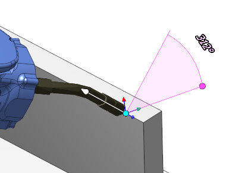

 モーションタイプ - ポイントに移動するタイプによって設定されます。 MultiGoto - マルチ座標移動  PhysicGoto - 物理的な機械軸の移動  衝突を回避 - 衝突回避運動

 軸 - 現在点での機械軸

軸を変更すると、2つのボタンが表示されます。

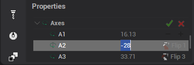

 - 点をマシンの先端に移動させます。

 - 以前の値に戻します。

  - 360/+360

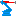 フリップ - ロボットのフリップを制御します。

<strong>補助点</strong>

 溶接ポイント はまた、追加の補助点を含んでいます。クリアランス アプローチ リターン

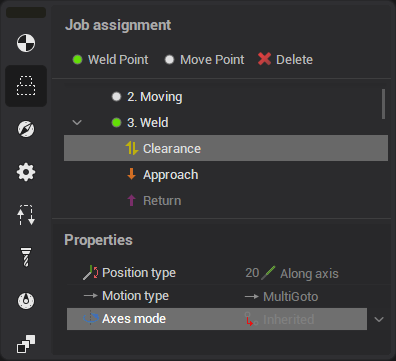

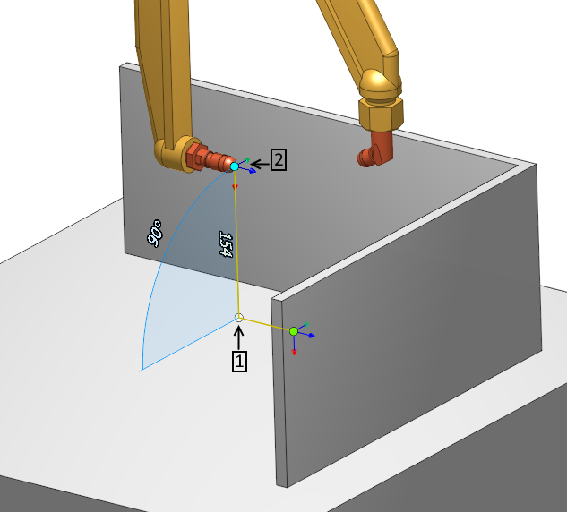
