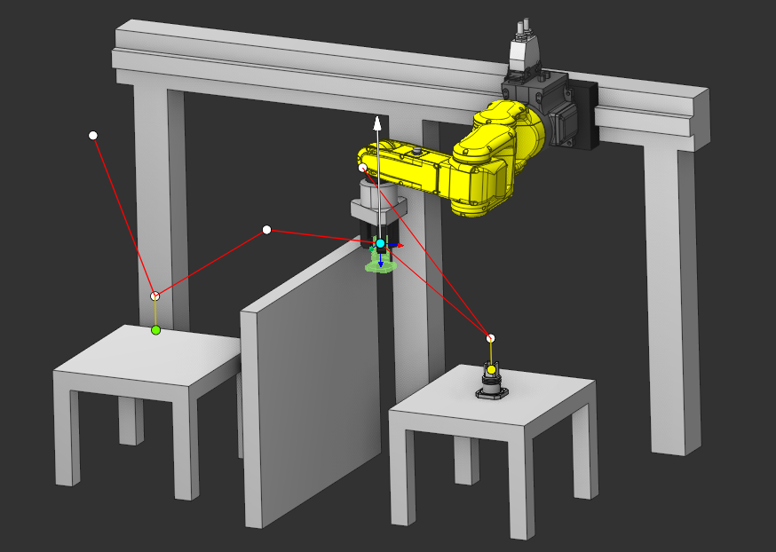
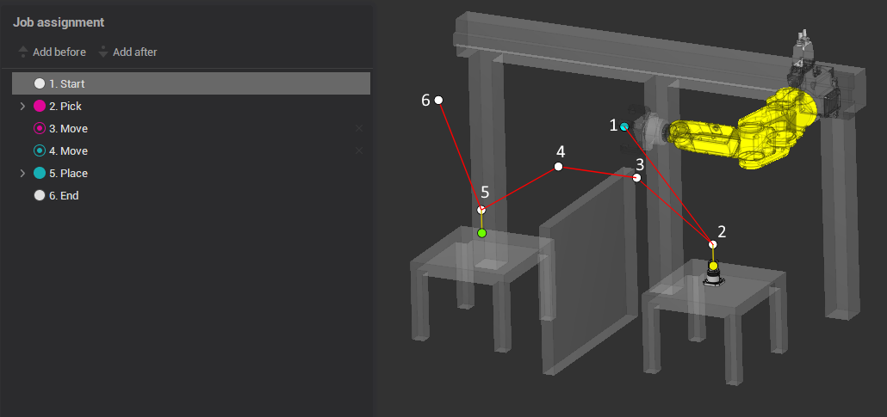
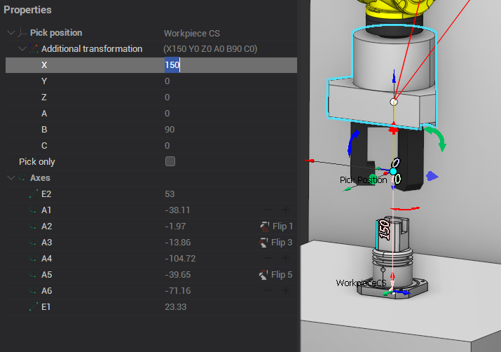
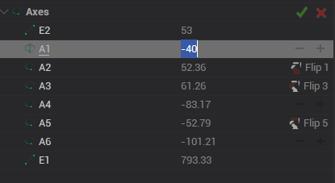
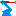
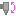
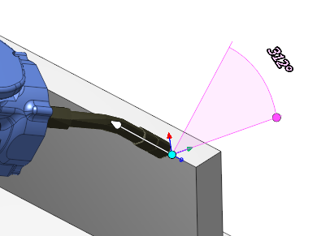
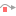
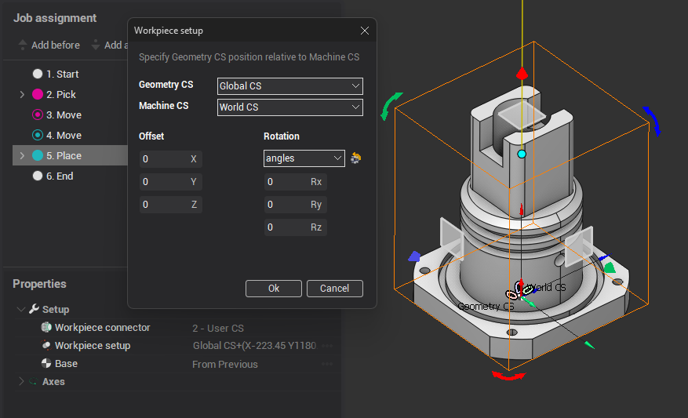
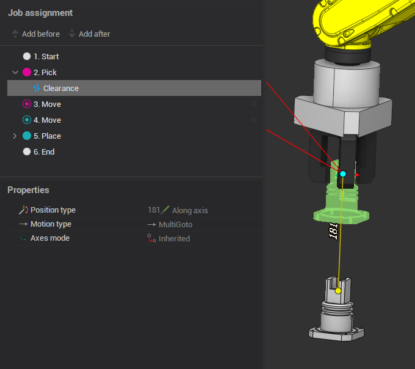

# Operação de pegar e colocar por ponto

Ela se baseia na operação [Pick-and-place](10404.md).

A <strong>definição da tarefa </strong> é construída a partir de pontos nodais. Em cada ponto, é definida uma posição para o movimento da máquina. Adicionando e removendo pontos, é possível definir o movimento desejado da peça.

A <strong>definição da tarefa</strong> é composta por vários tipos de pontos:

1.  Ponto inicial
2.  Ponto de pegar (Pick point)
3.  Ponto de movimentação (relativo ao ponto de pegar)
4.  Ponto de movimentação (relativo ao ponto de colocar)
5.  Ponto de colocar (Place point)
6.  Ponto final. Esses pontos podem ser usados para construir uma cadeia de percursos.

1.  Ponto inicial. É somente leitura. É o ponto final da operação anterior.
2.  Ponto de pegar. Posição em que a peça é agarrada. Propriedades:  A posição de pegar é definida no sistema de coordenadas geométrico com <strong>transformações adicionais.</strong> Se <strong>Pick only</strong> for selecionado, o percurso termina nesse ponto.  Axes - eixos da máquina no ponto atual. Ao alterar os eixos, aparecem dois botões:   - move o ponto para a ponta da máquina  - restaura os valores anteriores   - 360/+360  Flip - controla as configurações (flips) do robô
3.  Ponto de movimentação (relativo ao ponto de pegar). A página tem os botões "Add position before" e "Add position after" para adicionar pontos intermediários. Por padrão, os pontos são adicionados em relação ao ponto selecionado. Se a posição inicial da peça for alterada, por padrão esse ponto também se move. Propriedades:  Fix vX - ativa o modo de edição de 6 eixos:   Motion type - define o tipo de movimento até o ponto:
  - MultiGoto - movimento em várias coordenadas
  -  PhysicGoto - movimento dos eixos físicos da máquina
  -  Avoid collisions - movimento com prevenção de colisões
4.  Ponto de movimentação (relativo ao ponto de colocar). Difere do ponto anterior porque se move junto com a posição final da peça.
5.  Ponto de colocar. Posição em que a peça deve ser colocada. Essa posição é definida pelo [conector do bruto](54.md) e pela [configuração do bruto](10066.md). Todos os movimentos da garra são gerados no [sistema de coordenadas do bruto](726.md) definido. 
6.  Ponto final. É um retorno ao ponto de troca de ferramenta. Se estiver desativado, o percurso termina no ponto de colocar.

<strong>Ponto de folga (Clearance point)</strong>

Com esses pontos, é possível definir o comprimento e a direção dos movimentos de entrada/retração nas posições de pegar e/ou colocar.

 Como arrastar pontos no modo interativo está descrito na [operação de soldagem por pontos](20041.md).
