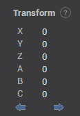

# スプラインの使用

## 複数の点を選択する方法

1. ボックス選択を使用します。
2. Shiftを押しながら点をクリックすると、最後に選択した点からクリックした点までの連続した範囲が選択されます。
3. Ctrlを押しながらクリックすると、複数の点を個別に選択できます。

## 点削除

点を右クリックするか、キーボードの**DELETE**キーを押すと、選択したすべての点が削除されます。

## アンドゥ、リドゥ

`Ctrl+Z`で直前の操作を取り消し、`Shift+Ctrl+Z`で直前の操作をやり直します。

## スプラインまたはスプラインの選択点を変換

変形パネルでは、スプラインまたはその選択点を、現在の座標系のXYZ軸に沿って周りに、指定したオフセット距離だけ移動または回転させることができます。

