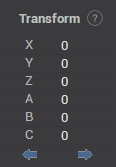

# Trabalho com splines

## Maneiras de selecionar vários pontos

1. Use a seleção de caixa.
2. Mantenha a tecla Shift pressionada e clique em um ponto para selecionar o intervalo contínuo de pontos desde o último ponto selecionado até o ponto clicado.
3. Mantenha pressionada a tecla Ctrl e clique para selecionar vários pontos individualmente

## Deletar pontos

Clique com o botão direito do mouse em um ponto ou pressione a tecla **DELETE** no teclado para excluir todos os pontos selecionados.

## Desfazer e refazer

Pressione `Ctrl+Z` para desfazer a última ação, pressione `Shift+Ctrl+Z` para refazer a última ação.

## Transformar a spline ou os pontos selecionados da spline

Com o painel de transformação, você pode mover ou girar a spline ou seus pontos selecionados pela distância de deslocamento especificada ao longo/ao redor dos eixos XYZ do sistema de coordenadas atual.

