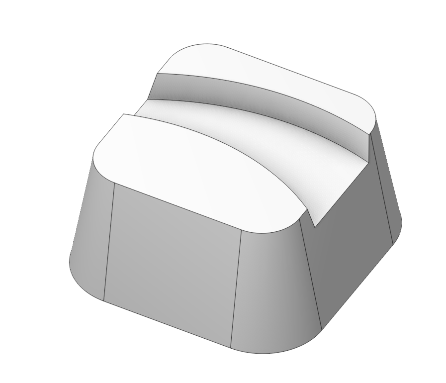
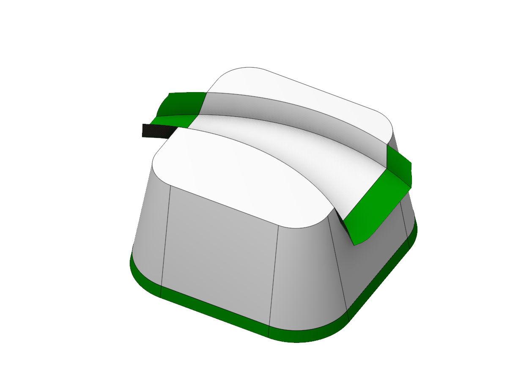
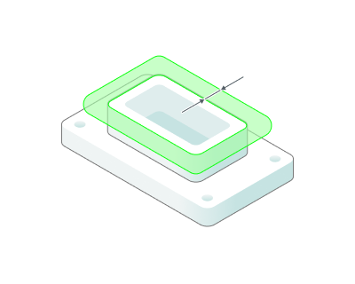
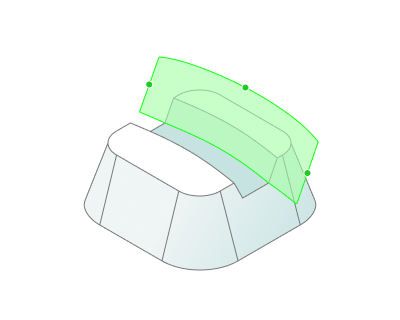
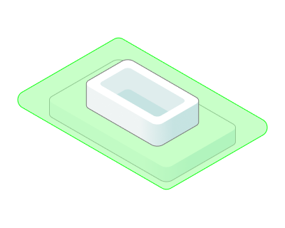

# サーフェスの延長

 

## 適用分野：

この機能は、元の表面を拡大し、サーフェスを完成させるエッジも拡大出来ます。モデルモード時に、上部パネルで使用可能です。 延長したい面のエッジを選択します。

<strong>延長距離</strong> 延長する必要のある値

<strong>延長タイプ</strong> 延長方法

<strong>エッジから等距離</strong> 元のサーフェスが拡張される（サーフェスの一部がねじれているため、拡張は不可能）。

<strong>接線エッジの補間</strong> まずエッジが延長され、その後にサーフェスが延長線上に沿って生成されます。

<strong>サーフェスUVボックス</strong> サーフェスのUV空間を作成します。このサーフェスには、面積を変化させるインタラクティブな要素があります。表面を選ぶ必要があります。

ご利用いただけないオプション：<strong>側面交互、元のサーフェスを保持</strong>

<strong>フロント側を交互</strong> リブのどちら側にサーフェスを延長するかの選択

 

<strong>元のサーフェスを保持</strong> 延長されたサーフェスは、元のサーフェスのコピーを持つ単一のサーフェスを形成します。

 

<strong>穴のキャップ</strong> 元のサーフェス上で指定された値以下の「半径」を持つ穴を閉じます。

 
