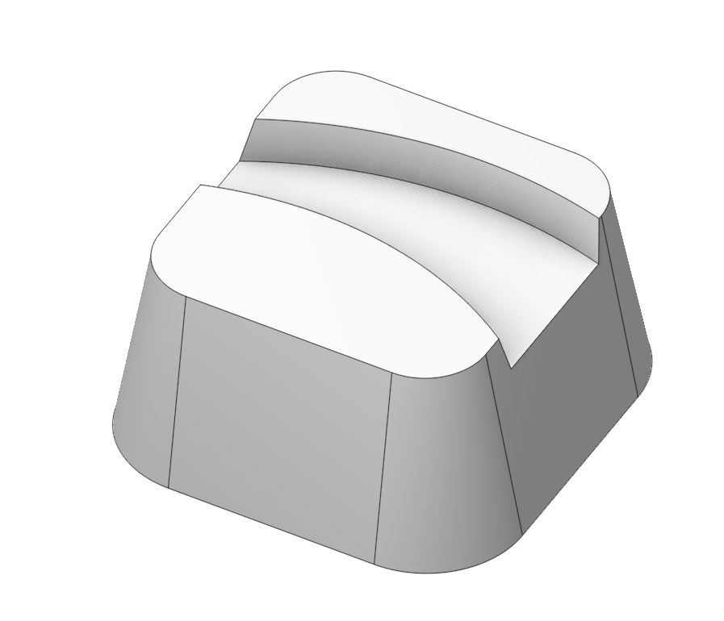
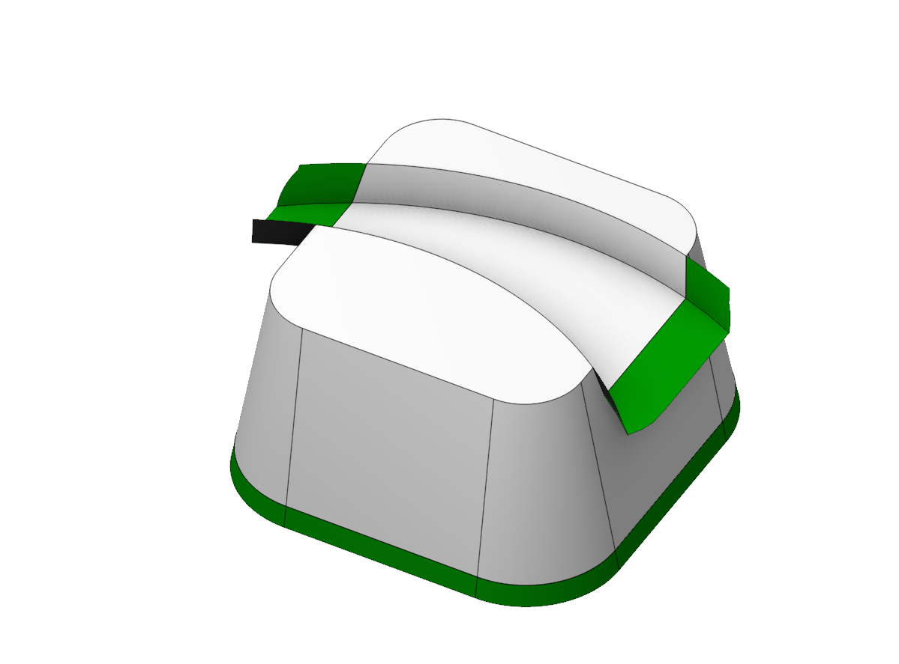
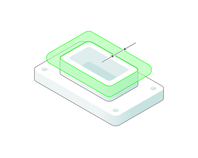
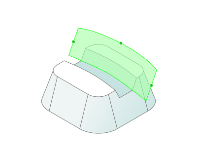
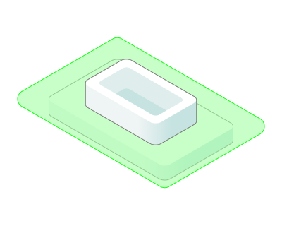

# Estender superfície

 

## Área de aplicação:

A ferramenta permite estender as superfícies originais e prolongar as arestas ao longo das quais as superfícies são completadas. Ela está disponível no modo de modelo, no painel superior. Selecione as arestas das superfícies que deseja estender.

<strong>Extension distance.</strong> Valor até o qual a superfície deve ser estendida.

<strong>Extension type.</strong> Método de extensão.

<strong>Equidistant to edges.</strong> As superfícies originais são estendidas. Como algumas superfícies são torcidas, a extensão pode ser impossível.

.png)

<strong>Interpolation of tangent edges.</strong> Primeiro, as arestas são estendidas; depois, a superfície é completada ao longo delas.

.png)

<strong>Surface UV Box.</strong> Permite criar o espaço UV da superfície. Essa superfície possui elementos interativos para alterar sua área. É necessário selecionar uma superfície.

Opções não disponíveis: <strong>Alternate from side, With source face.</strong>

<strong>Alternate front side.</strong> Seleciona o lado da aresta a partir do qual a superfície será estendida.

.png) .png)

<strong>With source face.</strong> A superfície estendida forma uma única superfície com uma cópia da superfície original.

.png) .png)

<strong>Hole capping.</strong> Fecha, na superfície original, os furos cujo raio seja inferior ao valor especificado.

.png) 
