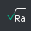
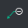
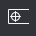
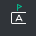

# アノテーション

-  <strong>テキスト</strong> 任意のテキストを作成できます。
-  <strong>ハッチング</strong> スケッチの閉じた領域をハッチング線で塗りつぶします。
-  <strong>表面粗さ</strong> 表面粗さ記号を追加します。
-  <strong>引出線</strong> 引出線付きの説明テキストを追加します。
-  <strong>幾何公差</strong> 幾何公差を指定するための公差記入枠を追加します。
-  <strong>データム形体</strong> 幾何公差を指定するためのデータム形体を示します。
