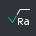
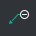
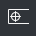
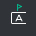

# Annotations

-  **Text.** Allows you to create custom text.
-  **Hatch.** Fills a closed sketch area with hatch lines.
-  **Surface roughness.** Adds a surface roughness symbol.
-  **Leader.** Adds explanatory text with a leader line.
-  **Geometric tolerance.** Adds a feature control frame to specify a geometric tolerance.
-  **Datum feature.** Marks a datum feature for specifying geometric tolerances.
