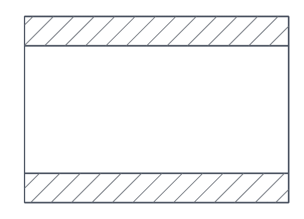

# Hatch

1. Click inside a closed area to create a hatch preview.
2. Click again to confirm it.

The hatch is linked to its boundary objects and rebuilds when they change.

**Angle.** Sets the direction of hatch lines.

**Step.** Sets the spacing between hatch lines.

**Fill.** Displays a translucent fill instead of lines.
