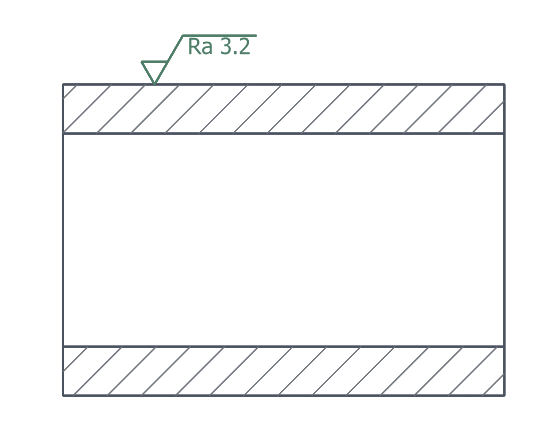

# Surface roughness

Creates a surface roughness symbol according to ISO 1302.

1. Click an edge.
2. Move the pointer to select the side.
3. Click again to place the symbol.

Clicking empty space places a free vertical symbol. Its position and angle replace **Other side** in the inspector. A symbol can also be placed on a leader shelf and moves with it.

**Symbol.** **Basic**, **Material removal required** or **Material removal prohibited**.

**Requirement.** The roughness parameter value.

**Second requirement.** An additional roughness parameter value.

**Manufacturing method.** The specified surface manufacturing method.

**Lay.** **None**, =, ⊥, X, M, C, R or P.

**Machining allowance.** The machining allowance shown in the symbol.

**All around.** Adds the all-around indication.

**Other side.** Changes the side of an edge-attached symbol; unavailable for a free symbol.
