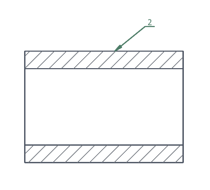

# Leader and item number

A leader consists of a pointer and a horizontal shelf with text above and below it.

1. Click to place the tip on an edge or in empty space.
2. Click to place the start of the shelf. Its length adjusts to the text.

**Text above shelf.** The upper text.

**Text below shelf.** The lower text.

**Leader end.** **Auto** uses an arrow on an edge and a dot in empty space. **Arrow**, **Dot** and **None** set the end explicitly.

**Item number** is a separate menu command that creates a leader with a number. The **Item number** row selects **on shelf** or **in circle**; **no** disables the item number. The default number is the next available number on the plane.
