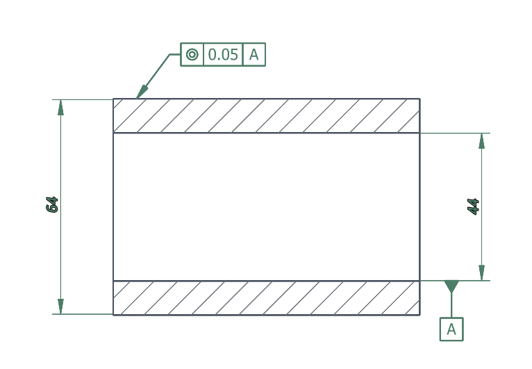

# Geometric tolerance and datum feature

**Geometric tolerance** creates a single-row frame containing a characteristic symbol, tolerance value and up to three datums.

1. Click an edge to place the arrow tip.
2. Click again to place the frame. Clicking empty space creates a frame without an arrow.

**Characteristic.** Selects one of 14 geometric characteristics: straightness, flatness, circularity, cylindricity, line profile, surface profile, parallelism, perpendicularity, angularity, position, concentricity, symmetry, circular runout or total runout.

**Tolerance.** The tolerance value.

**Diameter zone.** Adds ⌀ before the value.

**Material condition.** **None**, **Maximum material (M)** or **Least material (L)**.

**Primary datum**, **Secondary datum**, **Tertiary datum**. The datum letters.

**Datum feature** creates a filled triangle on an edge and a square containing a letter.

**Letter.** Defaults to the next available letter: A, B, C… excluding I, O and Q.

**Other side.** Changes the side of the datum symbol.
