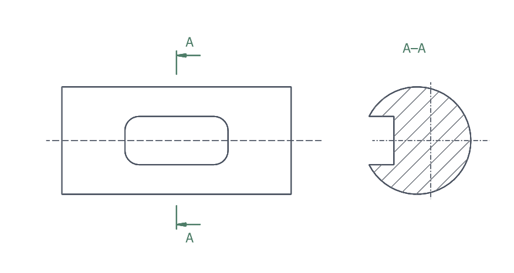

# Sections, view arrows and details

The **Section** command provides three types, selected in the inspector.

**Section line.** Click the start and end. The result has strokes with arrows and a letter at the ends. **Reverse view direction** reverses the arrows.

**View arrow.** Click the tip (the viewing direction), then the tail. The letter is placed at the tail.

**Detail.** Click the center, then the radius, then the start of the shelf. The result is a thin circle and a leader with a letter.

**Letter.** Defaults to the next available letter. A Russian interface uses Cyrillic; other interfaces use Latin letters.

## Section label

**Section label** places a view heading with one click, for example “A–A (2:1)”. It is linked to the section by its letter.

**Letter.** Identifies the section.

**Scale.** The scale shown in the heading.

**Rotated.** No rotation, **clockwise** or **counterclockwise**, with an angle.

**Text before**, **Text after**. Text placed before and after the heading.
