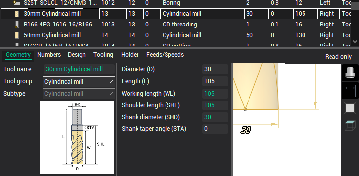
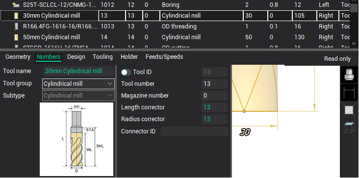
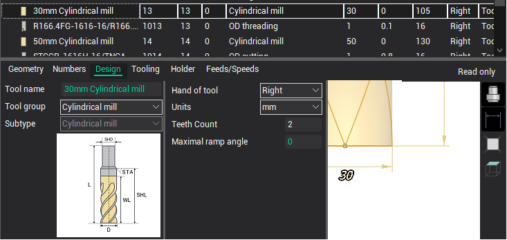
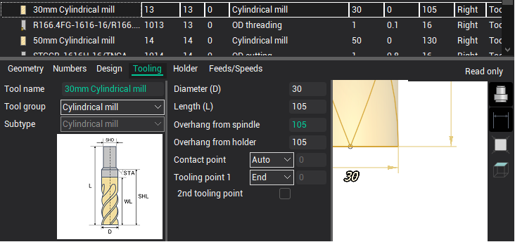
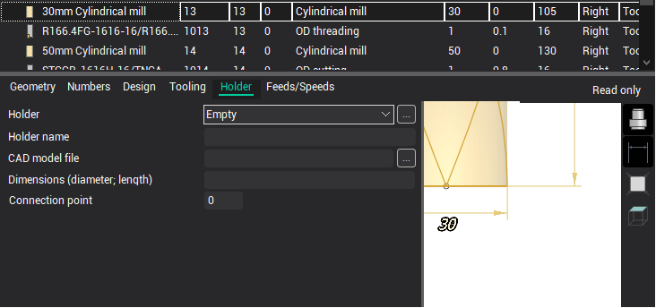
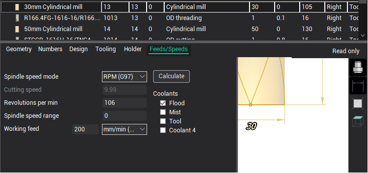

# Mill工具の編集

[工具ウィンドウ](38.md)でミーリング工具を選択すると、上図のようにウィンドウ下部にそのプロパティパネルが表示されます。

本システムでは、利用可能な幾何パラメータの内容に応じて、以下の種類のミーリング工具が用意されています。

- フラットエンドミル
- ボールエンドミル
- ブルノーズエンドミル
- バレルエンドミル
- 制限型バレルエンドミル
- テーパーボールエンドミル
- マイナス半径を持つミル
- テーパーエンドミル
- 彫刻用エンドミル
- ドリル
- カッター
- タップ
- ねじ切りミル
- センタードリル
- カウンターシンク
- Т-スロットミル
- [形状工具](10343.md)
- ナイフ
- ソーブレード
- プロービング
- スプレー
- 等々

形状タブのウィンドウで工具の幾何プロパティ一覧を表示するには、工具のグループとサブタイプを正しく選択する必要があります。

番号ページには、工具の識別情報（識別プロパティ）が表示されます。

- IDは、機械上の配置位置に依存しない一意の工具識別子です。
- 工具番号は、機械上の工具番号で、通常は工具が取り付けられている位置番号に対応します。
- 工具マガジン番号は、機械に複数のマガジンがある場合に使用されます。
- 長さ補正および径補正の補正番号は、機械の工具オフセットテーブル内で該当工具に対応するレコード番号です。

デザインページには、以下のパラメータが表示されます。

- 刃数
- 最大プランジ角度
- 工具単位（mm またはインチ）
- 工具寿命（分）

工具基準点タブには、以下のパラメータが含まれます。

- 工具突き出し量 - スピンドルの工具固定位置から工具先端までの距離
- 工具基準点 1 - パーツ原点に対して、Gコードで移動が定義される工具上の点
- 工具基準点 2 - 一部の工具タイプで使用され、Gコードが工具サイズに依存しないようにするための点
- 工具接触点 - オペレーションのジョブ割り当てで指定された幾何要素に、工具を主に接触させるための点

ホルダーページでは、ホルダーの各種パラメータを設定できます。

- ホルダー - 現在のライブラリおよびプロジェクトに登録されているホルダーのドロップダウンリストです。
- ホルダー名 - 任意のテキスト文字列でホルダー名を設定します。
- 寸法（直径、長さ）- 各ステップの直径と長さを定義する数値のペアをセミコロンで区切って入力します。
- 接続点 - ホルダーの最上部から、ホルダーとマシン主軸の接続点までの距離です。
- CADモデルファイル - ボタンをクリックすると標準のファイル選択ウィンドウが開きます。*.stl および *.osd 形式のファイルを指定できます。シミュレーション時の可視化および干渉チェック用のホルダー3Dモデルを設定します。
- 「...」ボタンをクリックすると、[ホルダーの選択および編集を行う](10341.md)ための新しいダイアログが開きます。

送り速度/回転数タブでは、以下のパラメータを編集できます。

- 主軸回転モード：一定回転数（rpm）または一定周速（CSS）を選択できます。
- 切削速度
- 主軸回転数
- 主軸回転数範囲
- 主軸回転方向
- 加工送りの値および単位
- クーラントチューブの有効化

