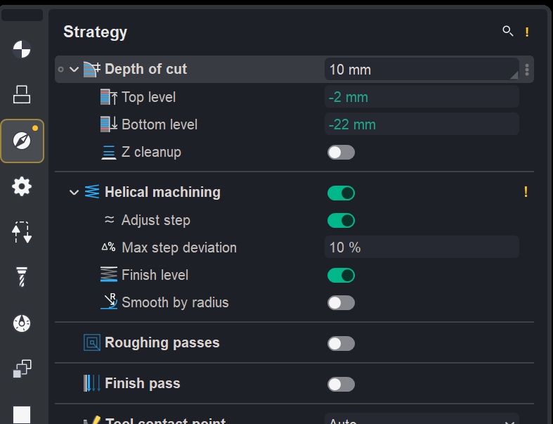

# Controle de recálculo do percurso da ferramenta

## Área de aplicação:

O **controle de recálculo do percurso da ferramenta** é usado para identificar as diferenças entre os parâmetros atuais da operação e os valores usados para calcular o percurso existente.

A função ajuda a localizar os parâmetros alterados, restaurar o estado dos parâmetros usado no cálculo anterior e atualizar as partes afetadas do percurso da ferramenta quando não é necessário um recálculo completo.

## Indicadores de parâmetros alterados:

**Estado calculado dos parâmetros.** O sistema CAM salva os valores dos parâmetros da operação quando o percurso da ferramenta é calculado. Esses valores são usados para identificar alterações posteriores.

**Status da operação.** Um **status de aviso amarelo** indica que os parâmetros atuais da operação diferem dos usados para calcular seu percurso da ferramenta.

**Indicadores do inspetor.** Os parâmetros alterados, seus grupos e as páginas correspondentes do inspetor são marcados para facilitar a localização das configurações que exigem recálculo.

<figure>

<figcaption><em>Indicadores de parâmetros alterados na página <strong>Strategy</strong>.</em></figcaption>
</figure>

## Recálculo e restauração de parâmetros:

**Recálculo parcial.** Se as alterações dos parâmetros não exigirem um recálculo completo, o percurso da ferramenta calculado é preservado. Somente as partes afetadas, como ligações, aproximações e retrações, são atualizadas.

**Restauração de parâmetros.** Antes do recálculo, é possível restaurar os valores dos parâmetros usados para calcular o percurso da ferramenta atual.

## Configurações:

**Auto-reset toolpath.** A configuração que oculta as indicações de alteração de parâmetros está em **System setup** > **Additional** > **Auto-reset toolpath**.
