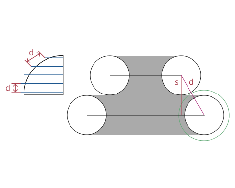
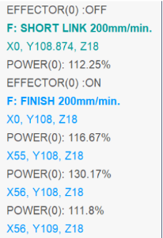
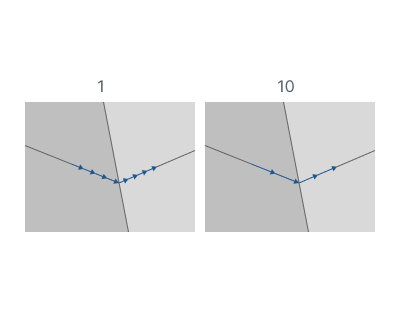

# Potência

<strong>Círculo verde</strong> — material extrudado real; <strong>círculo</strong> <strong>preto</strong> — material extrudado teórico.

<strong>S</strong> — passo horizontal

<strong>d</strong> — passo no plano

## Área de aplicação:

Esta opção ajusta a velocidade do extrusor de acordo com a altura da camada, modificando o parâmetro <strong>Power (material feed)</strong>. Por meio do link é possível consultar como trabalhar com o comando <strong>POWER</strong> no pós-processador. [Detalhes](https://docs.encycam.com/Inp/2/en/1020.html)

O valor é calculado da seguinte forma:

<strong>Power = d/S*100%</strong>

Assim, a função <strong>Power</strong> permite aumentar a alimentação de material de acordo com a variação do passo. Ou seja, quanto maior o passo, mais material precisa ser extrudado.

No CLDATA, o resultado aparece da seguinte forma:

<strong>Max dist deviation.</strong> Parâmetro de interpolação.

