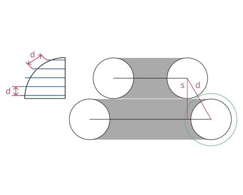
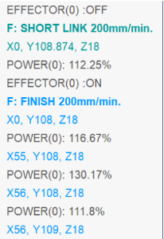
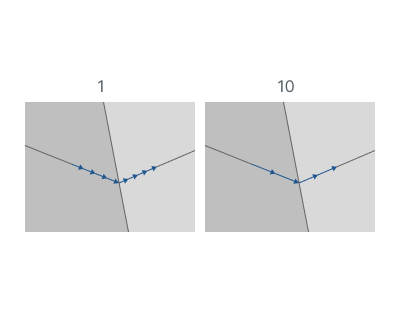

# 抽出量　(材料供給速度)

<strong>緑の円</strong> — 実際に押し出された材料、<strong>黒の円</strong> — 理論上の押し出し材料

<strong>S</strong> — 水平方向のステップ

<strong>d</strong> — 平面上のステップ

## 適用分野:

このオプションは、レイヤーの高さに応じて押出機の速度を調整し、<strong>抽出量（材料供給速度）</strong>パラメータを変更します。 リンクから、ポストプロセッサ内での <strong>POWER</strong> コマンドの使い方を学ぶことができます。 [詳細を見る](https://docs.encycam.com/Inp/2/en/1020.html)

計算式は以下の通りです。

<strong>Power = d / S × 100%</strong>

したがって、<strong>Power</strong>機能はステップの変化に応じて材料供給量（押出量）を増加させることができます。 つまり、ステップが大きいほど、より多くの材料を押し出す必要があります。

CLDATAでは、以下のように表示されます。

<strong>最大距離偏差</strong> 補間パラメータ

