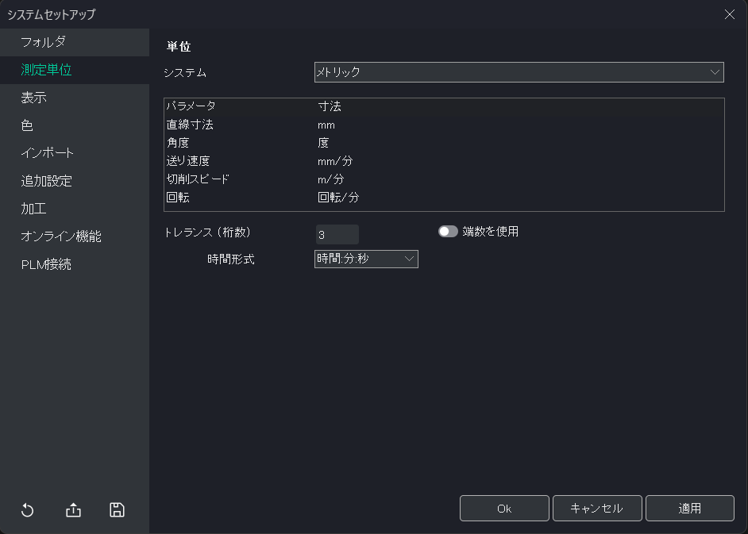

# <測定単位>タブ

測定単位設定では、システムの測定単位を定義できます。

測定値は、インポートされたモデルで使用されている単位に基づいています。また、出力データ（NC）も同じ単位を使用して作成されます。従って、CNCフライス盤用のNCプログラムをミリメートル（またはインチ）で生成するには、モデルのすべての寸法をミリメートル（またはインチ）にする必要があります。

<strong>角度の測定値</strong> は小数を含む度数で与えられます。

## 追加設定：

- <strong>`トレランス(桁数)`</strong>：NCプログラムに出力する値の小数点以下の桁数を定義します。この値は、NC機械の最大公差（またはNCプログラムの小数点以下の桁数）より少なくとも1桁多く設定することを推奨します。
- <strong>`時間形式`</strong>：加工時間など、時間出力のフォーマットを指定します。
- <strong>`端数を使用`</strong>: このオプションを有効にすると、必要に応じて分数表記（通分数）が使用できるようになります。
