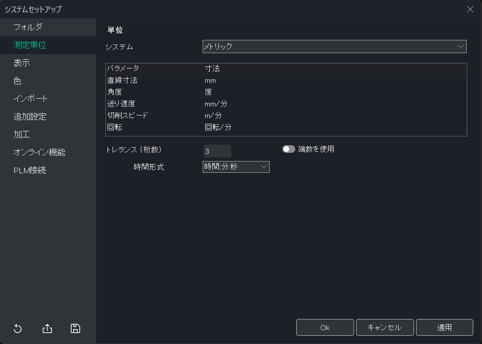

# Aba Unidades de medida

As configurações <strong>Measurement Units</strong> permitem definir as unidades de medida do sistema.

As medições se baseiam nas unidades usadas no modelo importado. Os dados de saída (NC) são criados nas mesmas unidades. Portanto, para gerar um programa NC em milímetros (ou polegadas) para uma fresadora CNC, todas as medidas do modelo devem estar em milímetros (ou polegadas).

As <strong>medidas angulares</strong> são expressas em graus com decimais.

## Configurações adicionais:

- <strong>`Tolerance (digits)`</strong>: define o número de dígitos após o separador decimal nos valores enviados ao programa NC. Recomenda-se definir esse valor com pelo menos um dígito a mais do que a tolerância máxima da máquina NC (ou do que o número de dígitos após o separador decimal no programa NC).
- <strong>Time format</strong>: especifica o formato de exibição do tempo, por exemplo, do tempo de usinagem.
- <strong>Use vulgar fraction</strong>: esta opção permite que o sistema use frações ordinárias quando apropriado.
