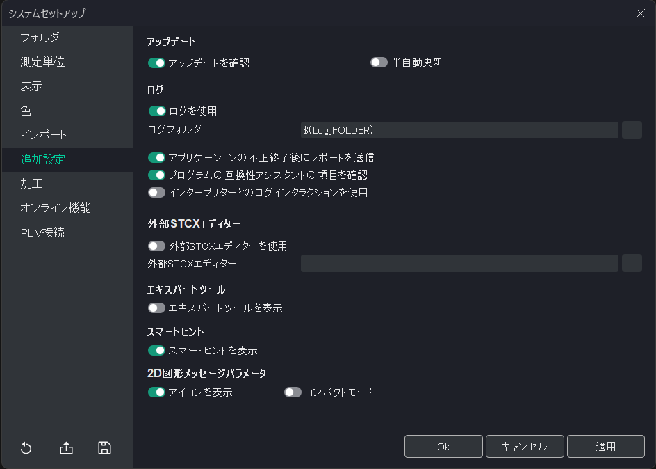
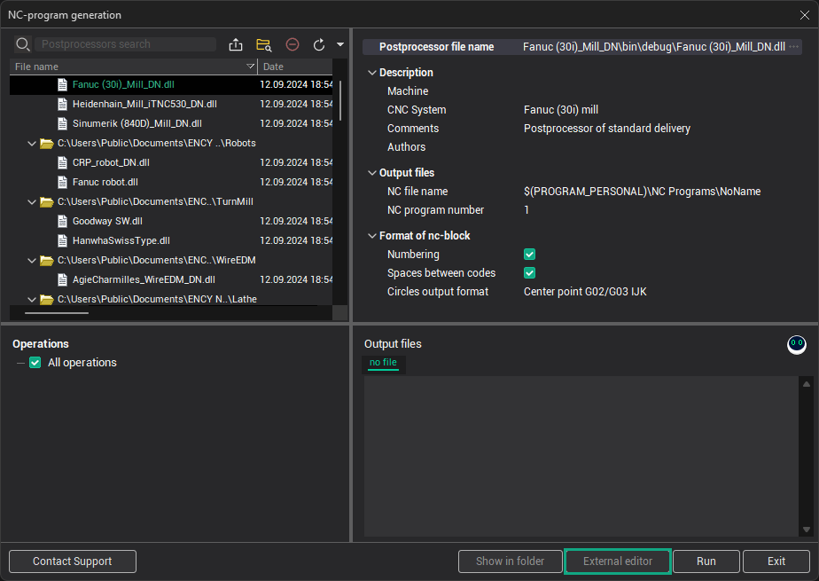
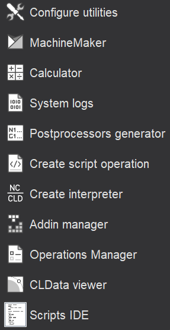
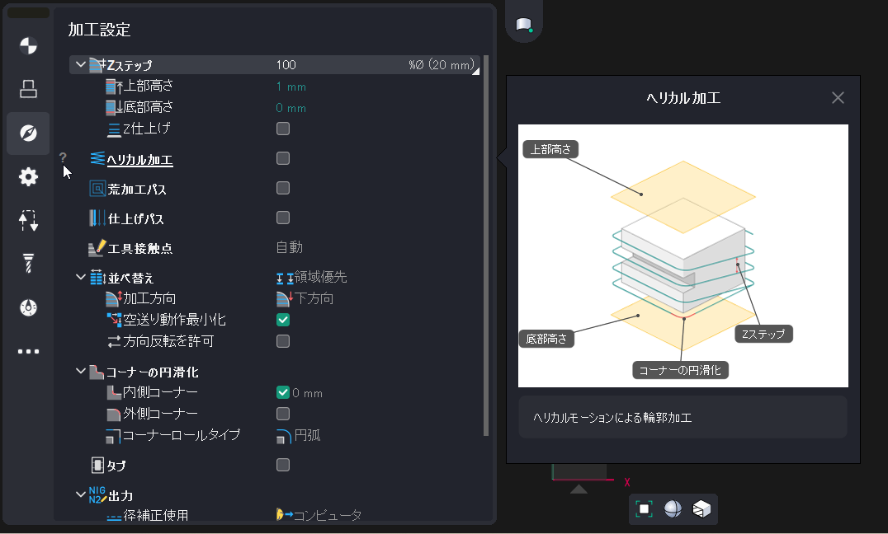

# Scheda Additional

Per configurare la registrazione degli eventi di sistema e le impostazioni di aggiornamento, utilizzare la pagina <strong>Additional</strong> (impostazioni aggiuntive).

I log sono utili quando si riscontrano problemi difficili da spiegare a parole o che si verificano solo quando viene eseguita una specifica sequenza di azioni.

## Impostazioni di aggiornamento:

- Per abilitare il controllo automatico degli aggiornamenti, attivare l'opzione <strong>Check for updates</strong> (verifica aggiornamenti).
- Abilitare <strong>`Semi-automatic update`</strong> (aggiornamento semiautomatico) per avviare il download degli aggiornamenti subito dopo aver fatto clic sulla notifica "Updates found" (aggiornamenti trovati).

## Impostazioni di registrazione:

- Per abilitare la registrazione, selezionare l'opzione <strong>Use logs</strong> (usa i log). I log sono utili per diagnosticare problemi difficili da descrivere o che si verificano solo durante una specifica sequenza di azioni.
- Il campo <strong>Log folder</strong> (cartella dei log) consente di specificare la posizione in cui il sistema salverà i file di log.
- Per inviare automaticamente le segnalazioni di errore, selezionare l'opzione <strong>Send report after incorrect application finish</strong> (invia rapporto dopo una chiusura anomala dell'applicazione).
- L'opzione <strong>Check Program Compatibility Assistance items</strong> esclude il sistema dai controlli di compatibilità con altri programmi eseguiti dall'[Assistente compatibilità programmi](https://msdn.microsoft.com/ru-ru/windows/compatibility/pca-scenarios-for-windows-8) (Program Compatibility Assistant).
- Per registrare l'interazione del sistema con l'interprete (utilizzato nella [Simulazione della lavorazione da programma NC](10291.md) e nelle [operazioni basate su codice G](10379.md)), abilitare l'opzione <strong>Use log interaction with the interpreter</strong> (registra l'interazione con l'interprete).

## Impostazioni dell'editor esterno:

Il pannello <strong>`External STCX-editor`</strong> (editor STCX esterno) riguarda la finestra di [generazione del programma NC](69.md) e consente di selezionare un editor esterno per modificare i programmi NC.

## Strumenti per esperti:

L'opzione <strong>Show expert tools</strong> (mostra strumenti per esperti) rende visibili gli strumenti avanzati per gli utenti esperti.

## Suggerimenti intelligenti:

L'opzione <strong>Show smart hints</strong> (mostra suggerimenti intelligenti) attiva o disattiva la visibilità dei suggerimenti intelligenti nell'interfaccia.

