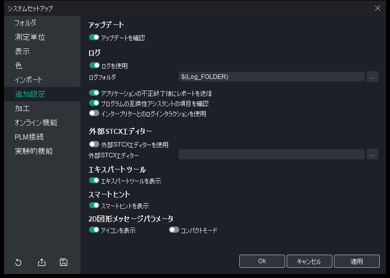
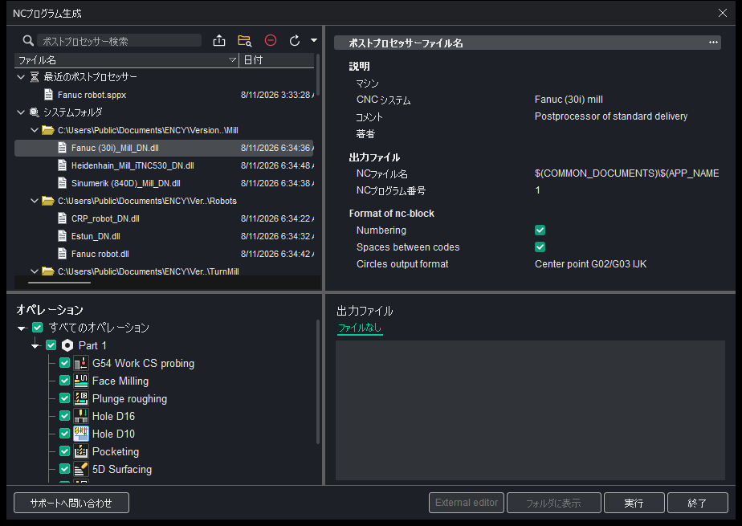
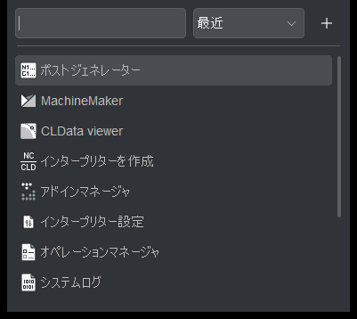
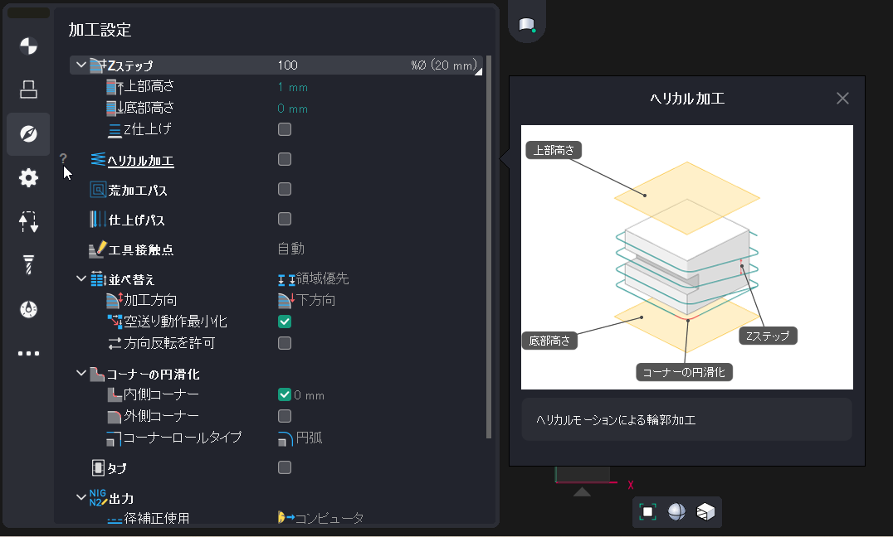

# Additional tab

To configure system event logging and update settings, use the **Additional** page.

Logs are useful when you encounter issues which are difficult to explain in words or which occur only when a specific consequence of actions is executed.

## Update Settings:

- To enable automatic update checks, switch on the **Check for updates** option.

## Logging Settings:

- To enable logging, check the **Use logs** option. Logs are useful for diagnosing issues that are difficult to describe or that occur only during a specific sequence of actions.
- The **Log folder** field allows you to specify the location where the system will save log files.
- To automatically send error reports, check the **Send report after incorrect application finish** option.
- The **Check Program Compatibility Assistance items** option excludes the system from compatibility checks with other programs by the [Program Compatibility Assistant](https://msdn.microsoft.com/ru-ru/windows/compatibility/pca-scenarios-for-windows-8).
- To log the system's interaction with the interpreter (used in [Simulation of machining by NC program](10291.md) and [G-code based operations](10379.md)), enable the **Use log interaction with the interpreter** option.

## External Editor Settings:

The <strong>`External STCX-editor`</strong> panel affects the [NC-program generation](69.md) window and allows you to select an external editor to modify NC programs.

## Expert Tools:

The **Show expert tools** option makes advanced tools visible for expert users.

## Smart Hints:

The **Show smart hints** option toggles the visibility of smart hints in the interface.

