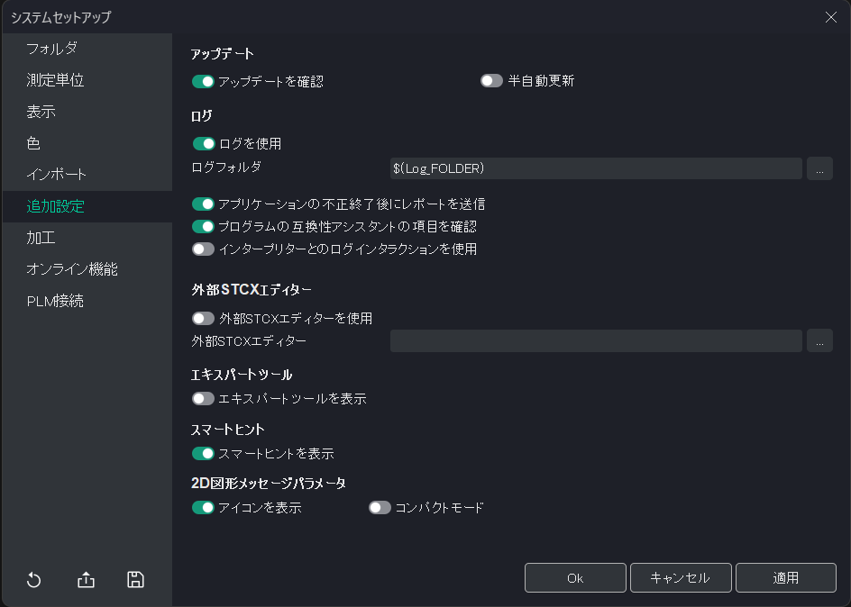
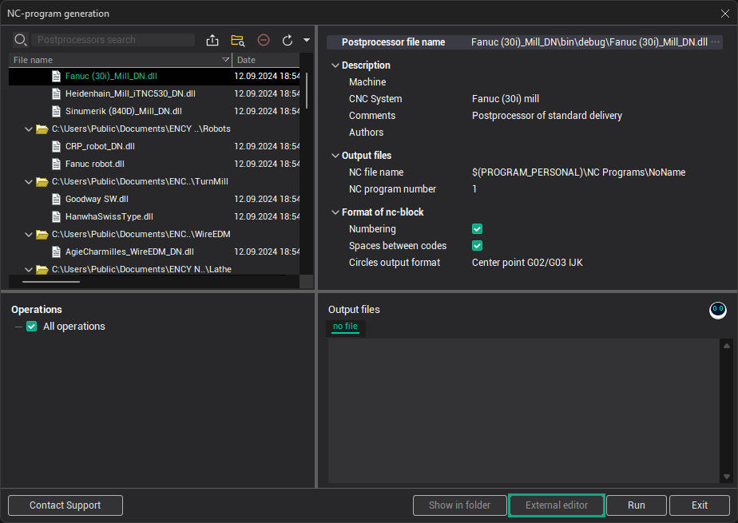
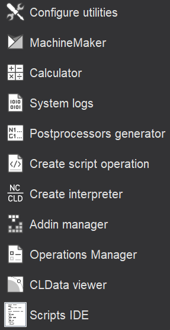
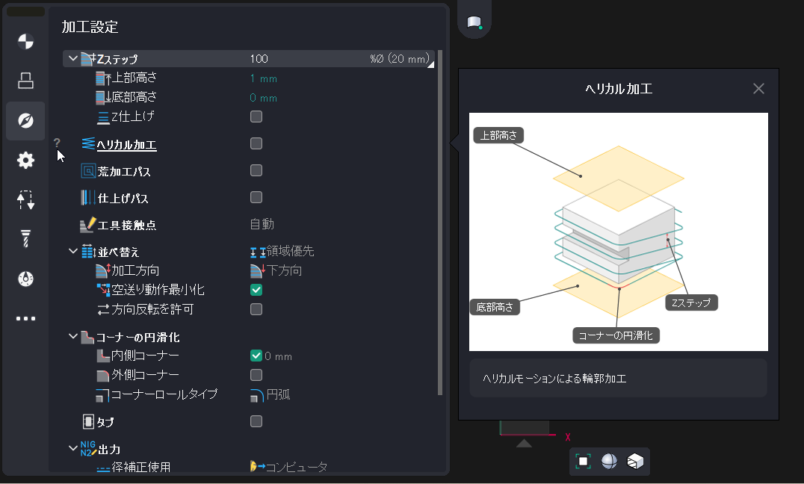

# <追加設定>タブ

システムイベントログとアップデートの設定を行うには、 <strong>`追加設定`</strong> ページを使用してください。

ログは、言葉で説明するのが難しい問題や、特定のアクションの結果が実行されたときにのみ発生する問題に遭遇した際に役立ちます。

## 設定を更新：

- 自動アップデートチェックを有効にするには、 <strong>`更新を確認`</strong> オプションをオンにします。
- <strong>`半自動更新`</strong> を有効にすると、"更新が見つかりました" 通知をクリックした後、すぐにアップデートのダウンロードが開始されます。

## ログの設定：

- ログを有効にするには、 <strong>`ログを使用`</strong> オプションをチェックしてください。ログは、説明が困難な問題や、特定の一連の動作中にのみ発生する問題を診断するのに役立ちます。
- <strong>`ログフォルダ`</strong> 欄では、システムがログファイルを保存する場所を指定できます。
- エラーレポートを自動的に送信するには、 <strong>`アプリケーション不正終了後にレポートを送信`</strong> オプションをチェックしてください。
- <strong>`プログラムの互換性アシスタンスの項目を確認`</strong> オプションは、 [プログラム互換性アシスタンス項目](https://msdn.microsoft.com/ru-ru/windows/compatibility/pca-scenarios-for-windows-8)による他のプログラムとの互換性チェックからシステムを除外します。
- ( [G-コードベースシミュレーション](10291.md) と [Gコードベースオペレーション](10379.md)で使われる) インタープリターとのシステムのやりとりを記録するには、 <strong>`インタープリターとのログインタラクションを使用`</strong> オプションを有効にします。

## 外部エディターの設定：

<strong>`外部 STCX エディター`</strong> パネルは、 [NCプログラム生成](69.md) ウィンドウに影響し、NCプログラムを修正するための外部エディタを選択することができます。

## エキスパートツール：

<strong>`エキスパートツールを表示`</strong> オプションは、エキスパートユーザー向けに高度なツールを表示します。

## スマートヒント

<strong>`スマートヒントを表示`</strong> オプションは、インターフェイス上のスマートヒントの表示/非表示を切り替えます。

