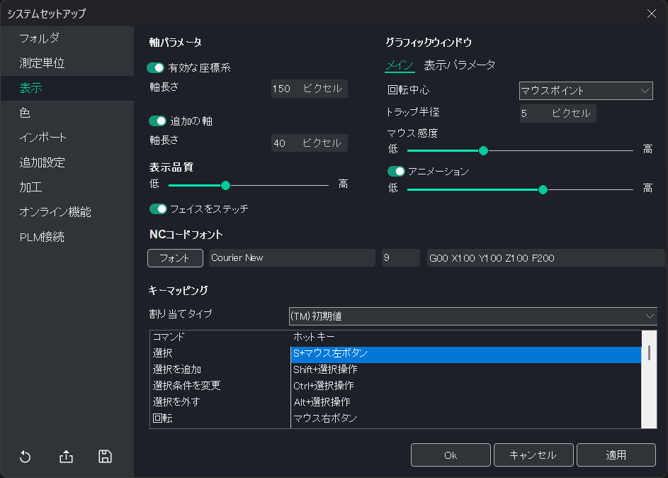

# <表示>タブ

[グラフィカルウィンドウ設定](169.md)では、表示内容や表示方法のパラメータを管理します。

- <strong>`軸パラメータ`</strong>：このパネルでは、座標系の表示と軸の長さを調整できます。 <strong>`有効な座標系`</strong> は実際の空間位置に表示されます。 <strong>`追加の軸`</strong> はグラフウィンドウの左側に描かれます。
- <strong>`表示品質`</strong>：このパネルでは、形状のデフォルトの表示品質を設定できます。下部のスライダーを動かすことで、表示精度が調整できます。この精度設定は、新しくインポートされたすべてのオブジェクトに適用されます。 <em>注意：低スペックのPCでは、高い精度を設定することは推奨されません。システムのパフォーマンスに悪影響を与える可能性があります。</em>
- <<strong>フェイスをステッチ</strong>：表示用にサーフェスを三角分割する際、このオプションを有効にすると、面が連結され、隙間が生じないようにします。

## グラフィックウィンドウの設定：

- `メイン`
  - <strong>`回転中心`</strong>：グラフィカルウィンドウの回転の中心点を定義します。
  - <strong>`トラップ半径 (px)`</strong>：オブジェクトの選択とハイライトを行う際のトラップサイズをピクセル単位で定義します。
  - <strong>`マウス感度`</strong>：マウス使用時の回転と拡大縮小の速度を制御します。
  - <strong>`アニメーション`</strong>：グラフィカルウィンドウの表示パラメータが瞬時に変化するときの中間フレーム数を指定します。
  - <strong>`視点`</strong>：視覚化時にオブジェクトに適用される遠近歪みの程度を決定します。
- <strong>`表示パラメータ`</strong>：
  - <strong>`レンダリングモード`</strong>：3つのオプションがあります。
  -
    1. <strong>`ハードウェア高速`</strong>：シェーダーベースのレンダリング
    2. <strong>`ハードウェア標準`</strong>：シェーダーなしでクラシックなハードウェアアクセラレーションOpenGLレンダリング
    3. <strong>`ソフトウェア（非常に遅い）`</strong>：OpenGLによるソフトウェア処理のみのレンダリングで、ビデオカードを使用しません。
  - <strong>`アンビエントオクルージョン`</strong>：オブジェクトのシェーディングを有効にして、奥行き感やリアリティを向上させます。
- <strong>`キーマッピング`</strong>：視覚化コントロール用のホットキーを定義します。CAMシステムは、他のシステムに慣れたユーザー向けに設計された4つのキーマッピング方式を用意しています。このパネルでは、キーマッピングの方式を選択できますが、ホットキー自体は読み取り専用で編集できません。
