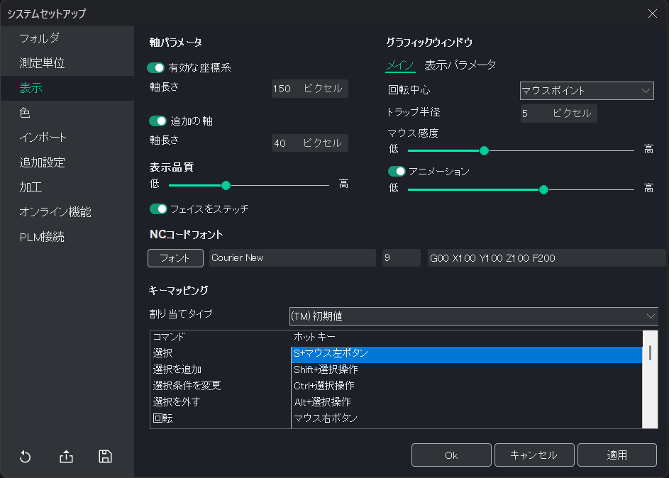

# Aba Visualização

As [configurações da janela gráfica](169.md) controlam os parâmetros de visualização e exibição.

- <strong>Axes parameters</strong>: este painel permite ajustar a visibilidade dos sistemas de coordenadas e o comprimento de seus eixos. O <strong>Active coordinate system</strong> é exibido no espaço real, enquanto os <strong>Additional axes</strong> são desenhados no lado esquerdo da janela gráfica.
- <strong>Visualization quality</strong>: neste painel, é possível definir a qualidade visual padrão dos objetos. O controle deslizante na parte inferior ajusta a precisão visual: quanto maior a qualidade, mais recursos do computador são necessários. Essa configuração de precisão se aplica a todos os objetos importados posteriormente. <em>Nota: não é recomendável definir alta precisão em computadores de baixo desempenho, pois isso pode prejudicar o desempenho.</em>
- **Stitch faces together**: ao triangular superfícies para visualização, esta opção garante que as superfícies sejam costuradas entre si, evitando lacunas entre elas.

## Configurações da janela gráfica:

- **Main**
  - <strong>Rotation centre</strong>: define o ponto central de rotação da janela gráfica.
  - <strong>`Trap size (px)`</strong>: define o tamanho da área de captura, em pixels, para selecionar e realçar objetos.
  - <strong>Mouse sensitivity</strong>: controla a velocidade de rotação e de escala ao usar o mouse.
  - <strong>Animation</strong>: especifica o número de quadros intermediários quando os parâmetros de vista da janela gráfica mudam instantaneamente.
  - <strong>Perspective</strong>: determina o grau de distorção de perspectiva aplicado aos objetos na visualização.
- <strong>Visual parameters</strong>:
  - <strong>Rendering mode</strong>: oferece três opções:
  -
    1. <strong>Hardware Advanced</strong>: renderização baseada em shaders.
    2. <strong>Hardware Standard</strong>: renderização OpenGL clássica acelerada por hardware, sem shaders.
    3. <strong>`Software (very slow)`</strong>: renderização por software com OpenGL, sem usar a placa de vídeo.
  - <strong>Ambient occlusion</strong>: ativa o sombreamento dos objetos para aumentar a profundidade e o realismo.
- <strong>Key Mapping</strong>: define as teclas de atalho para o controle da visualização. O sistema CAM oferece quatro esquemas de mapeamento de teclas, criados para usuários habituados a outros sistemas. Neste painel, é possível selecionar o esquema de mapeamento, mas as próprias teclas de atalho são somente leitura.
