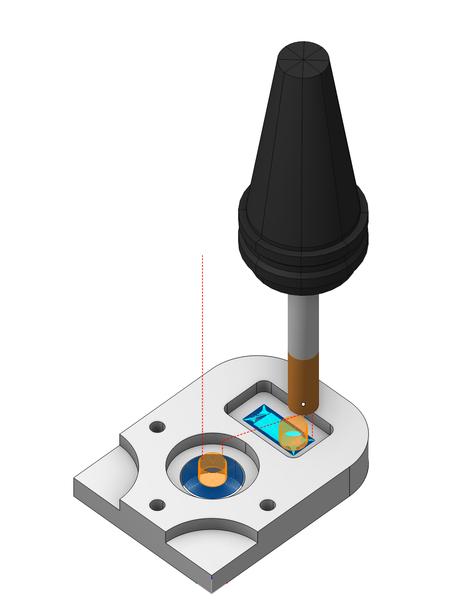
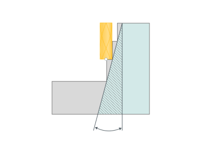
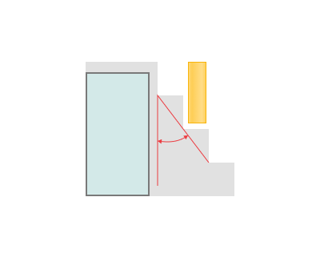

# ポケット加工

## 適用分野：

ポケット加工は、ポケットと島の2/2.5D加工や彫刻加工前の荒取りとしても利用されます。彫刻加工と同様に、加工対象モデルは曲線を水平（XY）平面に投影して形成されます。このモデルは、対象領域に対して曲線または曲線グループを順次追加することで作成されます。

### セットアップ：

<strong>セットアップ</strong> タブは、プロジェクトの主要なパラメータを設定するために使用されます。これには、装置上の部品の位置、部品の座標系などの設定が含まれます。[詳細を見る](1022.md)

### ジョブ割り当て：

<strong>基準サーフェス</strong> この面は、工具軌跡を投影するための基準面として使用されます。 [詳細を見る](10156.md)

<strong>ボスを追加</strong> ボスを追加できます。[詳細を見る](806.md)

<strong>ポケットを追加</strong> ポケットを追加できます。[詳細を見る](806.md)

<strong>反転追加</strong> 閉じた領域を指定し、その領域内での加工ルールを反転します。つまり、加工対象領域が非加工領域になり、非加工領域が加工対象領域となります。[詳細を見る](806.md)

<strong>上部高さ</strong> モデル要素によって上部高さを指定します。 [詳細を見る](10153.md)

<strong>底部高さ</strong> モデル要素によって底部高さを指定します。 [詳細を見る](10153.md)

<strong>プロパティ</strong> 要素のプロパティを表示します。残し代を追加することも可能です。また、リスト内の項目をダブルクリックすることでも、このメニューを呼び出せます。

<strong>削除</strong> リストから項目を削除します。

<strong>制限</strong> 加工してはならない領域を制限できます。[詳細を見る](101231.md)

### 加工設定：

#### 加工設定：

このパラメータにより、ポケット加工時に平行、等間隔などのツールパスを生成することができます。このパラメーターグループは <strong>ウォーターライン荒加工</strong>オペレーションと同様に機能します<strong>。</strong>[詳細を見る](736.md)

#### 加工高さ：

工具軸方向の加工範囲を設定します。このパラメーターグループは<strong>ウォーターライン荒加工</strong>オペレーションと同様に機能します。[詳細を見る](736.md)

#### 切込みステップ：

<strong>上部高さ</strong>と<strong>底部高さ</strong>の間で、工具軸方向に1回のパスで除去される素材の厚さを設定します。

詳細を表示

<strong>サイド角度</strong> これはワークの傾斜面を指し、頂点からのクリアランスを設定します。

<strong>サイド角度</strong>パラメータを 0° に設定すると、加工形状は単純な押し出し形状（エクストルージョン）になります。この押し出し形状の輪郭は、加工レベルの最上面（Z 平面）でスケッチまたは選択したジオメトリによって定義されます。

<strong>サイド角度</strong>を 0° より大きく 90° 未満の値に設定すると、CAM システムはテーパー状の側壁を自動的に生成します。これにより、側面が垂直軸（Z 軸）に対して傾斜した 3D 形状が作成され、その傾斜角度は指定した側面角度と正確に一致します。

<strong>逃げ角度</strong> 正の値を入力すると、加工深さが深くなるにつれて、ツールシャンクがワーク側面と干渉（擦れ）するのを防ぐことができます。

深い垂直壁を加工する際には、すでに加工済みのワークとのツール接触を制限する必要がある場合があります。そのため、レイヤーごとに加工を行うオペレーションでは、 逃げ角度を設定できます。垂直、または垂直に近い面を加工する場合、下図のように加工レイヤーごとに実際のストック（取り残し）が増加します。逃げ角度は、加工対象モデルの壁面だけでなく、加工を制限する壁面も含め、垂直または垂直に近いすべての壁面に適用されます。

逃げ角度には負の値を設定できず、90°以上の値も指定できません。また、逃げ角度を大きく設定しすぎると、下層のレイヤーに未加工材（取り残し）が多く残る原因となります。

#### ミーリングタイプ：

曲線加工オペレーションを除くほぼすべての加工で設定可能です。これにより、ツールパスの計算時に必要なフライス加工タイプ（ダウンカットまたはアップカット）を指定できます。このパラメーターグループは<strong>ウォーターライン荒加工オペレーション</strong>と同様に機能します。 [詳細を見る](736.md)

#### 並べ替え：

面加工時の工具経路の順序を設定します 。このパラメーターグループは<strong>ウォーターライン荒加工</strong>オペレーションと同様に機能します。 [詳細を見る](736.md)

#### コーナーのスムージング：

工具方向が急変すると、マシンの制御は方向転換の前に減速し、その後で再び加速します。この動作は、振動や工具・工作機械の摩耗を増やす原因となります。ツールパスの急な折れ曲がりを減らすか、なくすことで、この問題を軽減できます。そのため、モデルの内側・外側のコーナーを指定した半径で加工するツールパスのスムージング機能があります。このパラメータグループは、<strong>2D輪郭加工</strong>と同様に機能します。[詳細](404.md)

#### 工具接触点：

工具接触点（TCP）とは、加工中に工具とワーク表面、または幾何要素との間の主要な相互作用点を定義する、工具上の特定の点です。

このパラメータグループは <strong>5Dサーフェシング加工</strong> と同様に機能します。 [詳細を見る](10135.md)

#### 変換：

ツールパス変換するためのダイアログです。このパラメータグループは <strong>2D輪郭加工</strong>と同様に機能します。[詳細を見る](404.md)

### パラメータ：

このタブには、パーツ、ワーク、治具、およびその他の要素を制御するための主要なパラメータが含まれており、これらを調整することでツールパスを変更できます。 [詳細を見る](100112.md)

### リンク／リード：

リンク／リードタブでは、早送り動作のパラメータを設定します。これらの移動には、工具交換位置からのアプローチ、切削パス開始点までの位置決め、最終切削後の退避動作、加工パス間の移動、および工具交換位置への復帰が含まれます。また、座標軸に沿った動作の順序、これらの動作の軌跡、および移動量を設定できます。

詳細を表示

<strong>次の項目で構成されます。</strong>

<strong>アプローチ／リターン</strong> このパラメータグループは、工具交換位置から進入動作開始位置への工具の移動、および復帰の動作を管理します。[詳細を見る](100116.md)

<strong>安全動作</strong> 安全サーフェスのタイプとワークから安全サーフェスまでの距離を設定します。加工面またはツールパス間の移行を容易にし、アプローチまたはリターンの最初の段階がこの面に向かって行います。[詳細を見る](100117.md)

<strong>高度なリンク設定</strong> このパラメータグループは、回転軸の最適な動きを考慮した、主に5軸加工のための軌道形成方法を設定します。[詳細を見る](100118.md)

<strong>リンク</strong> 進入／退出リンクおよび加工パス間のリンクに関するルールを定義します。[詳細を見る](100120.md)

<strong>距離</strong> 送り切替に必要な距離です。 [関連項目](100139.md)

<strong>プランジを許可。</strong> 有効にすると、閉じたポケットを加工できます。外側から加工できない閉じたポケットをCAMシステムが検出すると、プランジ動作を生成します。[詳細](744.md)。

### 送り速度設定：

このダイアログを使用して、主軸回転速度、早送り速度、およびツールパスの各領域の送り速度を設定します。主軸回転速度は、毎分回転数または切削速度のいずれかで設定できます。設定値は下線が表示されます。もう一方の値は、工具径を考慮し、設定値に基づいて再計算されます。[詳細を見る](100142.md)

### 穴（穴加工点）

1. 穴加工点は、座標、深さ、工具径を含む編集可能な統合リストに保存され、外側からアプローチできない場合の進入点として使用されます。[詳細](125146.md)

### 変換：

オペレーション内で計算された工具の軌跡に対して座標変換を行うためのパラメータグループです。[詳細を見る](10168.md)

### パーツ：

パーツは、干渉をチェックを行う空間を定義する幾何要素のグループです。[詳細を見る](330.md)

### ワーク：

加工のワークモデルは、加工する素材を定義します。[詳細を見る](738.md)

### 治具：

治具には通常、チャック、グリップ、クランプなどの固定補助具、およびその他の種類の制限領域を指定します。[詳細を見る](10283.md)
