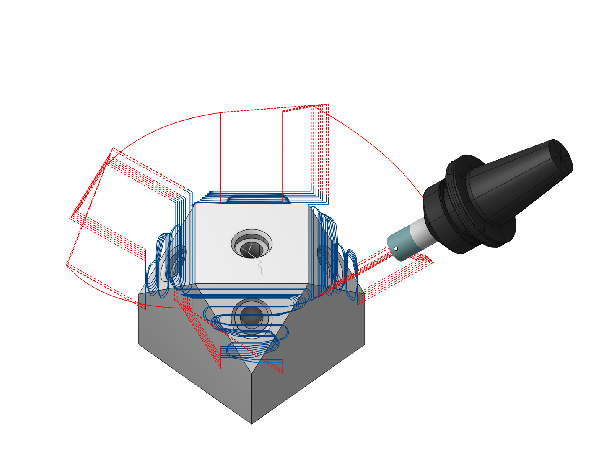

# Orientamento dell'utensile

 

## Ambito di applicazione:

Il posizionamento a 5 assi offre un metodo pratico per produrre pezzi che richiedono la fresatura su più facce, riducendo al minimo i piazzamenti. Il posizionamento a 5 assi si esegue impostando i valori appropriati nella sezione di parametri <strong>Tool orientation</strong> (orientamento dell'utensile) del pannello Setup dell'operazione. Tutte le operazioni di fresatura possono essere utilizzate per lavorare il pezzo da lati diversi. Se la macchina non consente di ruotare il pezzo o l'asse dell'utensile, è necessario modificare lo [schema di bloccaggio del pezzo](10066.md). Nel sistema CAM è possibile impostare facilmente la posizione degli assi rotativi <strong>facendo clic sulla faccia del pezzo</strong> a cui deve essere allineato l'asse dell'utensile

## Principi di lavoro con la finestra.

Per una determinata operazione è possibile impostare i valori effettivi della posizione degli assi rotativi secondo necessità. Dopo la generazione del percorso utensile, la sezione di avvicinamento (Approach) del CLData conterrà i comandi di posizionamento degli assi rotativi. L'intero programma viene quindi generato tenendo conto della nuova posizione degli assi rotativi.

### Finestra Tool orientation.

<strong>Up, Down, Front, Back, Left, Right.</strong> Per specificare uno degli orientamenti ortogonali standard, è possibile utilizzare i pulsanti con i nomi corrispondenti alla direzione desiderata (sopra, sotto, davanti, dietro, sinistra, destra)

<strong>View vector.</strong> È inoltre possibile orientare l'asse della macchina lungo il vettore di vista corrente utilizzato nella finestra grafica

<strong>X,Y, Z</strong>. Determinano il vettore di rotazione

Flank (fianco). Opzione che consente di orientare l'utensile lateralmente rispetto alla direzione selezionata anziché lungo di essa.

Rotation angle (angolo di rotazione). Angolo di rotazione aggiuntivo.

Alternate solution (soluzione alternativa). Opzione utile se la macchina consente di ottenere la stessa posizione relativa dell'utensile rispetto al grezzo in più modi.

È possibile impostare facilmente la posizione degli assi rotativi facendo clic sulla faccia del pezzo.

Per impostazione predefinita un'operazione genera il percorso utensile nel [sistema di coordinate del pezzo (G54 - G59)](10068.md), ma è possibile modificare questo comportamento specificando il parametro [sistema di coordinate locale dell'operazione](726.md) nel pannello Setup.

Molti controlli odierni richiedono la definizione del sistema di coordinate locale per il posizionamento a 5 assi. Senza questa definizione, la posizione del punto zero pezzo (G54) e la posizione del punto di riferimento dell'utensile non vengono aggiornate dopo la modifica della posizione degli assi rotativi: il controllo si comporta come se non sapesse nulla della cinematica della macchina, come un normale controllo a 3 assi. Quando invece si specifica il sistema di coordinate locale (la funzione PLANE su HDH, la funzione ROT su Sinumeric), il controllo aggiorna la posizione dello zero pezzo e la posizione della punta dell'utensile in base all'orientamento effettivo tra pezzo e utensile. Ciò è illustrato nelle figure seguenti.

Quando si modifica l'orientamento di un utensile, nella maggior parte dei casi è necessario impostare un sistema di coordinate locale affinché la macchina possa compensare la posizione del sistema di coordinate del pezzo e del punto di presetting dell'utensile. [Dettagli](726.md)

.png)

Posizione iniziale della macchina utensile (A0 C0). G54 si trova nell'angolo superiore sinistro del grezzo, il punto di presetting dell'utensile coincide con la punta.

.png)

Posizione della macchina dopo il posizionamento a cinque assi senza specificare un sistema di coordinate (A20 C-40). Lo zero pezzo e il punto di presetting dell'utensile non hanno cambiato la loro posizione nello spazio, mentre il grezzo e l'utensile sì. Il percorso calcolato dipenderà dalla posizione del grezzo sulla macchina e dalla sporgenza dell'utensile.

.png)

Posizione della macchina dopo il posizionamento a cinque assi con riferimento al sistema di coordinate (A20 C-40). G54 si trova di nuovo nell'angolo superiore sinistro del grezzo e il punto di presetting dell'utensile coincide di nuovo con la punta dell'utensile. Il programma di controllo calcolato sarà indipendente dalla posizione del grezzo sulla macchina e dalla sporgenza dell'utensile.

Per questo motivo, nella maggior parte dei casi, per i controlli dotati della funzione di rotazione del sistema di coordinate si consiglia di impostare il parametro Local SC su Auto. Per ulteriori informazioni, consultare la sezione [Sistema di coordinate locale](10068.md) di questo manuale.
