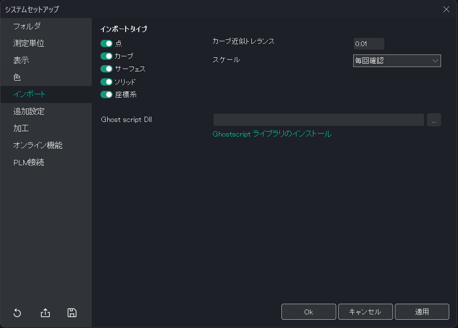

# Registerkarte Import

Hier legen Sie die allgemeinen [Importparameter](109.md) fest.

- Unter **Import types** (Importtypen) wählen Sie die [geometrischen Objekttypen](283.md), die aus CAD-Dateien importiert werden dürfen. Ist das Kontrollkästchen eines Typs deaktiviert, werden entsprechende Objekte beim Import ignoriert.
- Muss eine Kurve beim Import umgewandelt werden, erfolgt die Approximation mit dem unter **Curves approximation tolerance** angegebenen Wert.
- **Scale (Skalierung).** Steuert die Skalierung importierter Objekte.
- **Ghost script dll** wird für den Import von [PostScript-Dateien](268.md) verwendet.
