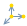
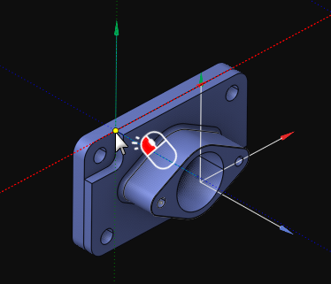
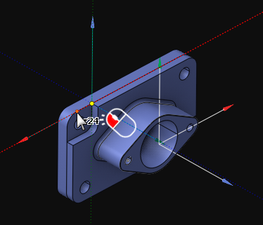
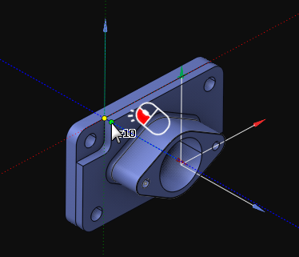
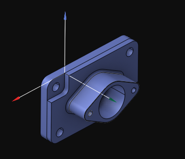

# Koordinatensystem durch Ursprungspunkt und zwei Richtungsvektoren erstellen

Diese Konstruktionsmethode wird über den Menüeintrag  auf dem [Koordinatensystempanel](753.md) aktiviert.

Das neue Koordinatensystem wird durch den Ursprungspunkt und zwei Richtungsvektoren für X und Y definiert. Bewegen Sie den Mauszeiger im [Grafikfenster](169.md) auf den gewünschten Ursprungspunkt. Ein geeigneter Punkt wird hervorgehoben. Bestätigen Sie ihn durch Klicken mit der linken Maustaste:

Legen Sie anschließend die Richtung der X-Achse fest, indem Sie einen Punkt auswählen, durch den die Achse verlaufen soll, und mit der linken Maustaste klicken:

Wiederholen Sie den Vorgang für die Y-Achse:

Danach wird das neu erstellte Koordinatensystem aktiv:

Name, Farbe und Ursprungspunkt können jederzeit [geändert](403.md) werden.
