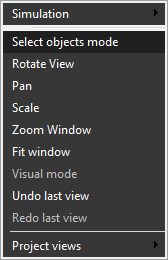

# Selezione dei comandi CL-data dalla vista grafica

Tutti i comandi CLDATA possono essere suddivisi in due gruppi: i comandi che spostano l'utensile e quelli che non lo spostano. Al primo gruppo appartengono comandi come **GOTO**, **CIRCLE**, **MULTIGOTO**, **MULTIARC**, **PHYSICGOTO**, **GOHOME**. Questi e altri comandi di movimento definiscono la curva del percorso utensile.

Se un percorso utensile è visibile (il pulsante  nel [pannello di visibilità](359.md) è selezionato), il nodo attivo (cioè selezionato) dell'albero, con tutti i suoi sottonodi, viene visualizzato nella vista. L'attivazione di un altro nodo dell'albero modifica la vista in modo da mostrare il frammento di percorso utensile corrispondente.

È possibile percorrere l'albero direttamente nella vista grafica.

Prima di selezionare il frammento di percorso utensile desiderato, abilitare l'opzione "Select objects mode" (modalità di selezione degli oggetti) nel menu a discesa della vista.

Spostando il mouse vengono evidenziati i frammenti all'interno del nodo selezionato. Per selezionare l'oggetto evidenziato occorre fare clic su di esso con il tasto sinistro del mouse. Il percorso utensile al di fuori del nodo selezionato viene mostrato in trasparenza e non può essere selezionato. Per passare al nodo padre del nodo selezionato è sufficiente fare doppio clic nella vista.
