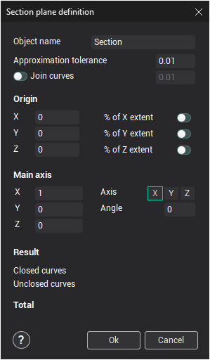

# Intersezione

Una sezione è un elemento parametrico del modello geometrico. L'oggetto sezione viene aggiunto a una cartella dell'albero geometrico per ottenere automaticamente le curve di intersezione di tutte le facce e le mesh della cartella con il piano di sezione definito.

Premere il pulsante  nella modalità **Model** per creare l'oggetto sezione per la cartella attiva. Successivamente viene attivata la modalità di definizione del piano di sezione e compare la finestra dei parametri del piano.

Il piano di sezione è definito dal punto origine, dalla direzione dell'asse principale e dall'angolo di rotazione attorno all'asse.

Le coordinate del punto origine possono essere definite nel pannello **Origin** mediante coordinate assolute oppure in percentuale delle dimensioni complessive del modello intersecato. Per il secondo caso occorre selezionare i campi associati.

Il punto origine può essere definito in modo interattivo nella [finestra grafica](169.md). A tale scopo occorre fare clic una volta con il tasto sinistro del mouse sul piccolo riquadro del punto origine e spostarlo in una nuova posizione. Fare di nuovo clic una volta con lo stesso tasto del mouse per fissare lì il punto origine.

La direzione dell'asse principale può essere definita mediante le coordinate del secondo punto nei campi del pannello **Main axis** oppure scegliendo un asse nello stesso pannello. Anche la direzione dell'asse principale può essere definita in modo interattivo. Il metodo interattivo è analogo alla definizione del punto origine.

Il valore dell'angolo di rotazione attorno all'asse principale è definito nel pannello **Main axis** oppure in modo interattivo. È possibile trascinare il piano di sezione in una nuova posizione lungo uno degli assi o per un punto qualsiasi del piano.

Il pannello **Result** mostra il numero delle curve di intersezione per i parametri correnti. Le curve sono calcolate con il valore di **Approximation tolerance** (tolleranza di approssimazione). Se l'opzione **Join curves** (unisci curve) è selezionata, il sistema tenta di unire tutte le curve risultanti con la tolleranza definita.

La sezione progettata è rappresentata come un gruppo di curve. Le curve possono essere modificate, copiate in un'altra cartella o eliminate. Tuttavia le curve vengono rigenerate quando cambia un oggetto della cartella associata.

I parametri della sezione possono essere modificati. Occorre selezionare la sezione e scegliere la voce **Modify Plane** (modifica piano) nel menu a comparsa della modalità **Model**.
