# 旋盤加工の切削条件

現在の旋盤オペレーションの送り速度および主軸回転数は、パラメータウィンドウの送り速度設定ページで設定します。以下にその画面を示します。

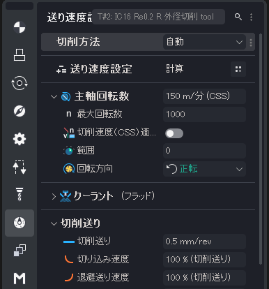

主軸回転数

回転速度の設定方法は、回転数を直接指定する **RPM**と、一 定表面速度 **CSS**を使用する方法の2種類があります。

**RPM**の場合は、回転速度は一定です。

**CSS**の場合は、NC装置が現在の加工径に応じて主軸回転速度を計算します。この場合、最大主軸回転数によって **RPM** の上限が制限されます。また、切削速度および送り速度の計算には[計算機](100142.md)を使用することもできます。

切削速度（CSS）適用前の回転数

工具が工具交換位置にあり、主軸がCSSモードで有効になっている場合、工具がワークの軸から離れすぎているため、主軸は低速で回転します。

最初の早送り移動では、工具が軸方向へ移動することで主軸が急加速します。これは、機械にとって好ましくありません。この問題を解決するため、一部の工作機械メーカーでは、まず主軸をRPMモードで起動し、加工送り開始位置でCSSモードへ切り替えることを推奨しています。

「切削速度（CSS）適用前の回転数」機能を有効にすると、最初の加工点でのRPMと同じ回転数で主軸をRPMモードにて起動し、アプローチ後にCSSモードへ切り替えます。

範囲

機械固有の回転速度範囲（機械式ギアボックス付き機械の場合）を示します。

<strong>送り速度</strong>

ツールパスの各セグメントに対して、それぞれ異なる送り速度を設定することができます。オペレーションの種類によってツールパスを構成するセグメントが異なるため、設定できる送り速度の項目数も変化します。

すべての送り速度タイプを以下の表に示します。

|   |   |
|---|---|
| 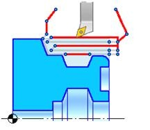 | 全ての補助送り 切削を行わないすべての送り速度です。 ツールパスの開始位置へ工具を移動する際に使用します。 |
|   |   |
| 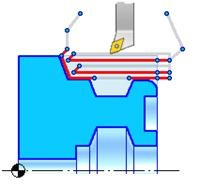 | 全ての加工送り 切削を行うすべての送り速度です。 |
|   |   |
| 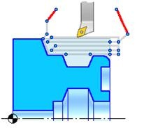 | 早送り速度 安全平面間を移動する際に使用します。 早送りが適用されているツールパスセグメントは赤色で表示されます。 早送りに切り替えるには、CLData の RAPID コマンドが使用されます。 |
|   |   |
| 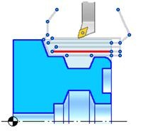 | 切削速度 加工送りの送り速度を設定します。これは、基準となる送り速度です。 他のすべての送り速度は、この切削 速度 に対する割合（%）として設定できます。 |
|   |   |
| 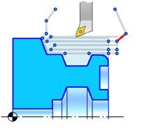 | アプローチ送り速度 開始点から最初のアプローチ開始点まで、工具が切削領域へアプローチする際に使用する送り速度を設定します。 |
|   |   |
| 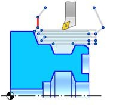 | リターン速度 最後の加工パスの終点から終了点まで、工具を戻す際に使用する送り速度を設定します。 |
|   |   |
| 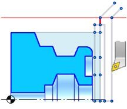 | 切込み速度 ツールパスの最初の点へ進入する際に使用する送り速度を設定します。 デフォルトでは加工送りと同じ値になります。 |
|   |   |
| 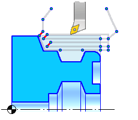 | 退避送り速度 加工パス後に、加工面から 工具を 退避させる際に使用する送り速度を設定します。 デフォルトでは加工送りと同じ値になります。 |
|   |   |
| 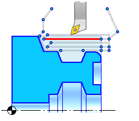 | 最初の切削速度 ワークから最初のレイヤーを除去する際に使用する送り速度を設定します。 ワークのサーフェスに鋳肌などの硬い層（クラスト）がある場合、最初の切削速度は加工速度より低く設定する必要があります。 |
|   |   |
| 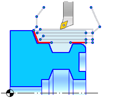 | 仕上げ速度 荒加工オペレーションにおいて、必要な表面粗さを得るために加工サーフェスに沿って移動する際の送り速度を設定します。 |
|   |   |
| 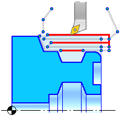 | 移行速度 次の加工パスへ移動する際に使用する送り速度を設定します。 |

送り速度の値は、以下の単位で定義できます。

- `mm/分` – 1分あたりの移動距離として送り速度を設定します。
- `mm/回転` – 主軸1回転あたりの工具移動距離として送り速度を設定します。
- `加工速度に対する%` – 加工速度の値に対する割合（%）で送り速度を設定します。例えば、値が100%の場合は、加工速度と同じ送り速度になります。値が50%の場合は、加工速度の半分の送り速度になります。

<em>注: 加工速度を変更すると、加工速度に対する割合で設定されているすべての送り速度も自動的に変更されます。</em>
