# Condições de corte das operações de torneamento

Os avanços e a rotação do fuso da operação de torneamento atual são definidos na página de avanços da janela de parâmetros, mostrada abaixo:

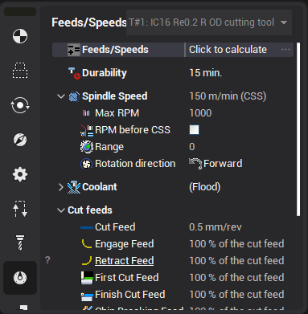

<strong>Velocidade</strong>

Há duas formas de definir a rotação do fuso: diretamente em rotações por minuto (**RPM**) ou com velocidade de corte constante (**CSS**). Na primeira, a rotação é constante. Na segunda, o comando NC calcula a rotação de acordo com o diâmetro de usinagem atual; nesse caso, a rotação máxima do fuso limita as **RPM**. Também é possível abrir a [calculadora](100142.md) de velocidades e avanços.

<strong>RPM antes de CSS</strong>

Se a ferramenta estiver na posição de troca e o fuso for ligado no modo CSS, o fuso gira lentamente, pois a ferramenta está muito longe do eixo da peça. No primeiro movimento rápido, o fuso sofre uma aceleração enorme, porque a ferramenta se aproxima do eixo, o que é prejudicial à máquina. Para resolver esse problema, alguns fabricantes de máquinas recomendam ligar o fuso no modo RPM e mudar para o modo CSS no ponto em que começa o avanço de trabalho. Assim, "RPM before CSS" liga o fuso no modo RPM com uma rotação igual às RPM do primeiro ponto de trabalho e, após a aproximação, muda para o modo CSS.

<strong>Faixa</strong>

Faixa é a gama de velocidades específica da máquina (com caixa de engrenagens mecânica).

Avanço

É possível definir o avanço para os diferentes trechos do percurso da ferramenta. Dependendo do tipo de operação, o percurso pode conter trechos diferentes, por isso a quantidade de avanços varia.

Todos os tipos de avanço estão listados na tabela abaixo:

|   |   |
|---|---|
| 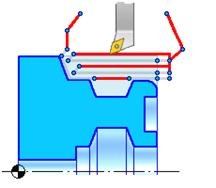 | Todos os avanços auxiliares Todos os avanços em que não há remoção de cavaco. Usados para deslocar a ferramenta até o início do percurso de trabalho. |
|   |   |
| 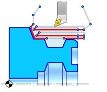 | Todos os avanços de trabalho Todos os avanços em que há remoção de cavaco. |
|   |   |
| 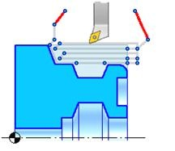 | Avanço rápido Usado nos deslocamentos pelos planos de segurança. Os trechos do percurso com avanço rápido são exibidos em vermelho. Para passar ao avanço rápido, é usado o comando RAPID do CLData. |
|   |   |
| 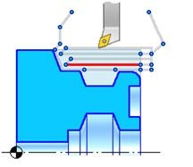 | Avanço de corte Define o avanço do movimento de trabalho. É o avanço principal. Todos os outros avanços podem ser definidos em porcentagem do avanço de corte. |
|   |   |
| 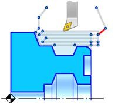 | Avanço de aproximação Define o avanço com que a ferramenta se desloca do ponto inicial até o início da primeira aproximação na zona de corte. |
|   |   |
| 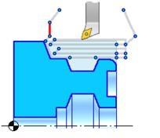 | Avanço de retorno Define o avanço com que a ferramenta retorna do último ponto da última passada até o ponto final. |
|   |   |
| 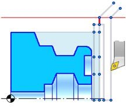 | Avanço de entrada Define o avanço usado na entrada até o primeiro ponto do percurso de trabalho. Por padrão, é igual ao avanço de trabalho. |
|   |   |
| 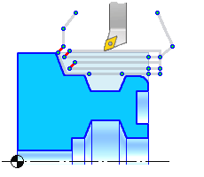 | Avanço de saída Define o avanço usado no afastamento da superfície após o movimento de trabalho. Por padrão, é igual ao avanço de trabalho. |
|   |   |
| 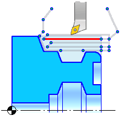 | Avanço do primeiro corte Define o avanço usado para remover a primeira camada do bruto. Se o bruto tiver casca, o primeiro avanço deve ser menor que o avanço de corte. |
|   |   |
| 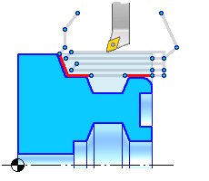 | Avanço de corte de acabamento Nas operações de desbaste, define o avanço do movimento ao longo da superfície usinada para obter a rugosidade necessária. |
|   |   |
| 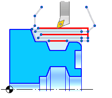 | Avanço transversal Define o avanço usado no movimento até a próxima passada de trabalho. |

Os valores dos avanços podem ser definidos em:

- `mm/min` – define o avanço como comprimento de deslocamento por minuto;
- `mm/rev` – define o avanço como comprimento de deslocamento da ferramenta por rotação do fuso;
- `in % of the cut feed` – define o avanço em porcentagem do avanço de corte. Por exemplo, se o valor for 100%, o avanço é igual ao avanço de corte; se for 50%, o avanço é igual à metade do avanço de corte.

<em>Observação: se o avanço de corte for alterado, todos os avanços definidos em porcentagem do avanço de corte também serão modificados.</em>
