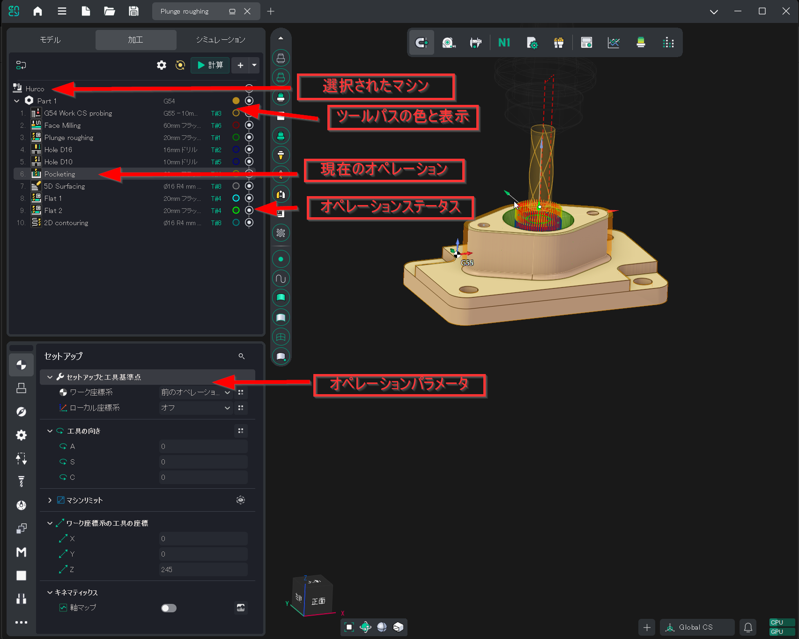
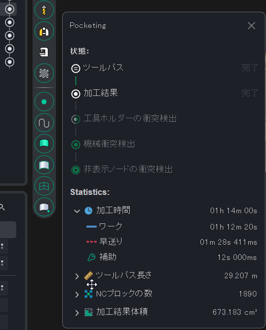
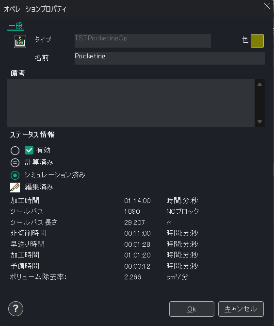

# Definizione della sequenza di lavorazione

Prima di definire una sequenza di lavorazione occorre specificare il pezzo da produrre, il grezzo e le attrezzature di bloccaggio della sequenza. In altre parole, occorre definire prima che cosa si produce (il pezzo), poi da che cosa lo si produce (il grezzo) e solo dopo come lo si produce (la sequenza di lavorazione).

Il **Part** (pezzo) specificato viene controllato da tutte le operazioni create successivamente, indipendentemente dal fatto che un'operazione lavori l'intero pezzo o solo una sua parte.

Il modello del **Workpiece** (grezzo) deve essere necessariamente specificato, tranne nei casi in cui il pezzo viene lavorato solo con operazioni di finitura senza tenere conto dei grezzi iniziali e intermedi. Il modello del grezzo deve essere un solido, cioè rappresentare uno spazio delimitato. Le facce che compongono il grezzo devono essere cucite con la tolleranza prescritta oppure chiuse fino al livello specificato. Il grezzo può essere definito anche mediante solidi generati da curve oppure costruiti attorno al pezzo (ad esempio un parallelepipedo o un cilindro attorno al pezzo). Il grezzo definisce il materiale iniziale che viene modificato dalle operazioni di lavorazione. In altre parole, il grezzo di un'operazione è il risultato della lavorazione dell'operazione precedente. Di conseguenza, la modifica di un'operazione cambia i dati di ingresso di tutte le operazioni successive e ne comporta il reset. Il grezzo della sequenza di lavorazione viene utilizzato anche in modalità **Simulation** (simulazione) come materiale iniziale.

Le **Fixtures** (attrezzature) definiscono le restrizioni iniziali, cioè le zone che non devono essere lavorate. Se nessuna operazione ridefinisce le attrezzature, queste si applicano a tutte le operazioni.

Il **Machining Result** (risultato della lavorazione) è il materiale che rimane dopo la lavorazione del grezzo da parte di una serie di operazioni. Questo nodo è stato introdotto per consentire un controllo visivo del materiale residuo e per rendere trasparente il passaggio del grezzo da un'operazione all'altra. L'elemento viene calcolato automaticamente e il suo contenuto non può essere modificato. Se il percorso utensile di un'operazione non è ancora stato generato, il risultato della lavorazione di tale operazione coincide con il suo grezzo.

In modalità tecnologia, la parte superiore della finestra contiene la sequenza strutturata delle operazioni di lavorazione e i nodi per accedere facilmente ai parametri principali delle operazioni. La parte inferiore contiene i parametri del nodo selezionato.

- **New** (nuovo): apre la finestra di dialogo per creare una nuova operazione. Se l'operazione corrente è un gruppo, la nuova operazione viene creata all'interno del gruppo corrente. Altrimenti, la nuova operazione viene inserita dopo quelle selezionate.
- **Parameters** (parametri): apre la finestra di dialogo per modificare i valori dei parametri dell'operazione corrente: utensile, avanzamento, avvicinamento-retrazione, strategia.
- **Run** (esegui): avvia il calcolo del percorso utensile per l'operazione corrente. Se l'operazione corrente è un gruppo, vengono calcolate tutte le operazioni in esso contenute.
- **Reset** (azzera): azzera il percorso utensile dell'operazione corrente. Se l'operazione corrente è un gruppo, viene eliminato il percorso utensile di tutte le operazioni del gruppo.

L'operazione corrente può essere eliminata, rinominata, copiata o tagliata negli Appunti con i tasti standard oppure dal menu contestuale:

- [Canc] – elimina l'operazione corrente;
- [Ctrl+R] – rinomina l'operazione corrente;
- [Ctrl+X] – taglia l'operazione corrente negli Appunti;
- [Ctrl+C] – copia l'operazione corrente negli Appunti;
- [Ctrl+V] – inserisce l'operazione dagli Appunti. L'operazione viene aggiunta alla fine del gruppo corrente.

La struttura dell'albero delle lavorazioni può essere modificata con il mouse. A tale scopo, tenere premuto il tasto sinistro del mouse sull'operazione desiderata e spostarla nella posizione voluta.

Accanto a ogni operazione è presente un'icona che ne indica lo stato. [Dettagli](1118119.md)

Le informazioni dettagliate sull'operazione, compreso il suo stato, sono visualizzate nella finestra delle proprietà. Per aprirla, fare clic con il tasto destro del mouse sull'operazione e selezionare la voce "Properties:" dal menu contestuale.

La finestra mostra il tipo di operazione con l'icona corrispondente, il nome dell'operazione e il colore del percorso utensile. Se l'operazione è stata calcolata, vengono indicati il numero di comandi del percorso utensile e il tempo di lavorazione. Se l'operazione è stata simulata, vengono indicati i tempi passivi, di lavoro, in rapido e ausiliari. Se durante la simulazione sono stati rilevati errori, vengono visualizzate le informazioni sugli errori.
