# Bauteil, Rohteil und Spannmittel definieren

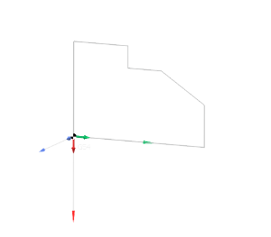 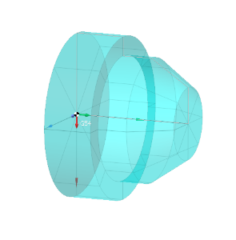

## Anwendungsbereich:

Mit diesen Elementen definieren Sie [Bauteil](330.md), [Rohteil](738.md), [Bearbeitungsbegrenzungen](101231.md) und [Spannmittel](10283.md).

Jeder Listeneintrag legt eine Fläche, einen Körper oder ein anderes bei der Werkzeugwegberechnung zu berücksichtigendes Element fest. Die Beschriftung zeigt dessen vollständigen Pfad im Geometriebaum. Wird das Ausgangsobjekt gelöscht oder umbenannt, wird der Eintrag mit einem Fragezeichen markiert. Das Symbol links kennzeichnet den Typ bzw. die Ableitung aus der Ausgangsgeometrie. Zum Hinzufügen verwenden Sie die entsprechenden Schaltflächen.

**Face (Fläche).** Fügt ausgewählte Flächen zur Liste hinzu. Ist keine Fläche ausgewählt, wird ein Dialog mit dem Geometriebaum geöffnet.

Weitere Informationen anzeigen

Wählen Sie in diesem Dialog die benötigten Flächen, Netze und Gruppen. Bei einer Gruppe werden nur ihre 3D-Objekte berücksichtigt. Bei der Rohteildefinition erzeugt **Add Faces** aus den ausgewählten Flächen einen **Volumenkörper**, der einen geschlossenen Raum beschreibt und mit  gekennzeichnet wird.

Ein Volumenkörper kann auf zwei Arten erzeugt werden:

- Durch Vernähen der Flächen. Sie müssen einen oder mehrere geschlossene Körper bilden. Die Verbindungstoleranz wird im eingeblendeten Dialog festgelegt.
- Durch Schließen der Flächen bis zu einer angegebenen Z-Ebene.

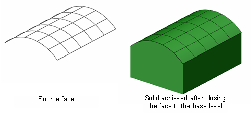

**Primitive (Grundkörper).** Definiert ein Rohteil mithilfe verschiedener Grundkörpervorlagen.

Weitere Informationen anzeigen

**Workpiece of the previous operation (Rohteil der vorherigen Operation).** Ein Verweiseintrag stellt die Beziehung zur vorherigen Operation her. Das referenzierte Objekt kann wiederum auf ein anderes Objekt verweisen. Änderungen am Ausgangsobjekt setzen die abhängigen Einträge zurück bzw. lösen deren Neuberechnung aus.

**Machining result of the previous operation (Bearbeitungsergebnis der vorherigen Operation).** Verwendet einen Verweis auf das vorherige Bearbeitungsergebnis. Änderungen des Ausgangsobjekts wirken sich auf die abhängigen Verweise aus und erfordern gegebenenfalls eine Neuberechnung.

**Restrictions of the previous operation (Begrenzungen der vorherigen Operation).** Übernimmt die Definition aus dem vorherigen Element, beispielsweise einer Operation, Aufspannung oder Bauteilgruppe.

**Empty workpiece (Leeres Rohteil).** Definiert ein leeres Rohteil; dies wird häufig beim Lackieren verwendet.

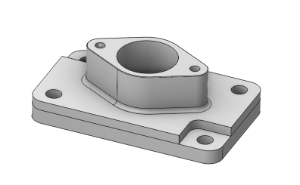

**Box (Quader).** Definiert ein einfaches prismatisches Rohteil um das Bauteil.

Weitere Informationen anzeigen

**Definition method (Definitionsmethode).**

**Around part (Um das Bauteil).** Erzeugt einen Quader mit den angegebenen Aufmaßen. Diese beziehen sich auf die Bauteilabmessungen.

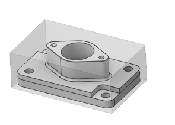

**Around geometrical model (Um geometrisches Modell).** Bezieht die Aufmaße auf die ausgewählte Geometrie, beispielsweise Bauteile oder Flächen.

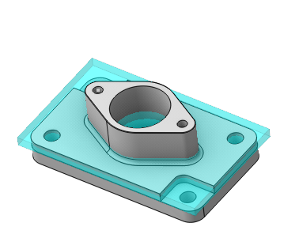

**From center point (Vom Mittelpunkt).** Definiert das Rohteil anhand des Mittelpunkts Pc und seiner Abmessungen.

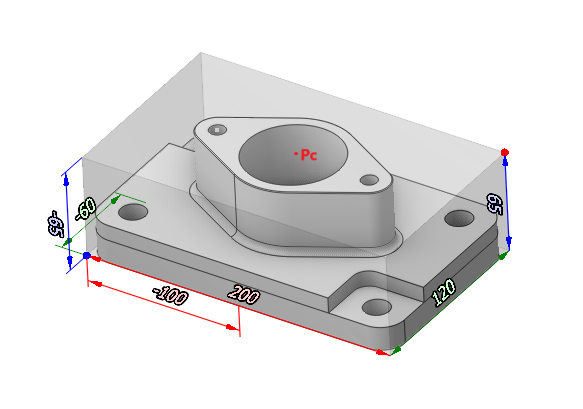

**From bottom southwest point (Vom unteren südwestlichen Eckpunkt).** Definiert das Rohteil anhand des unteren Eckpunkts P und seiner Abmessungen.

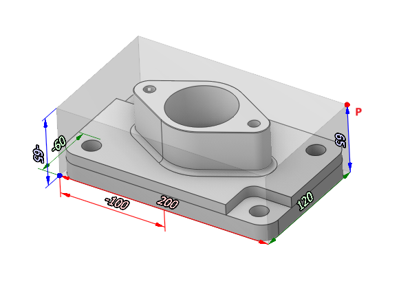

**From two points (Durch zwei Punkte).** Definiert das Rohteil zwischen P1 und P2. Die Koordinaten werden entlang X, Y und Z relativ zum globalen Koordinatensystem angegeben.

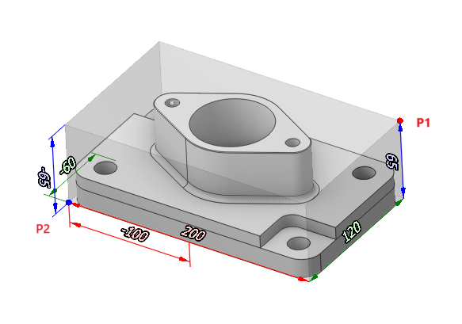

**Cylinder (Zylinder).** Definiert einen Zylinder um das Bauteil als Rohteil.

Weitere Informationen anzeigen

**Around part (Um das Bauteil).** Erzeugt einen Zylinder anhand der Bauteilabmessungen und einer globalen Koordinatenachse, wenn **Center of Box** ausgewählt ist.

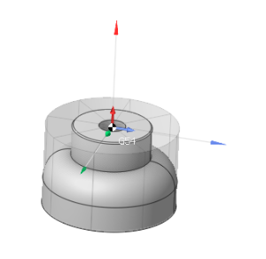

**Around geometrical model (Um geometrisches Modell).** Erzeugt den Zylinder anhand des ausgewählten Elements, beispielsweise einer Fläche oder eines Bauteils, und einer globalen Koordinatenachse, wenn **Center of Box** ausgewählt ist.

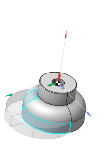

Bei **Center of CS** wird das Rohteil entsprechend um das ausgewählte Koordinatensystem aufgebaut.

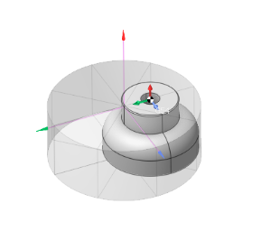

**From center point (Vom Mittelpunkt).** Definiert das Rohteil anhand des Mittelpunkts Pc und seiner Abmessungen.

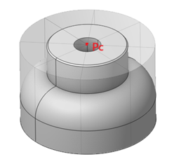

**Tube (Rohr).** Definiert einen Zylinder mit mittiger Öffnung um das Bauteil. Die Einstellung entspricht der Zylinderdefinition.

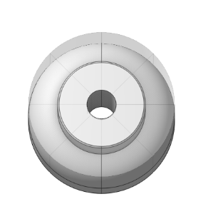

**Turn Envelope (Rotationshülle).** Erzeugt ein rotationssymmetrisches Rohteil um das Bauteil.

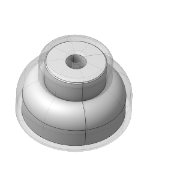

**Castling (Gussrohteil).** Definiert ein Rohteil mit gleichmäßigem Abstand zur Bauteiloberfläche.

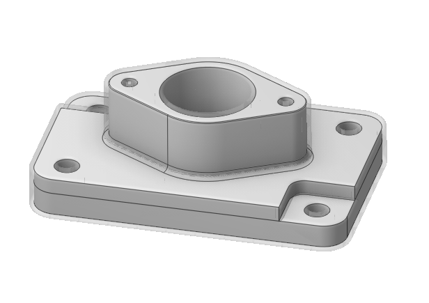

**Polygonal prism (Polygonprisma).** Definiert ein polygonales prismatisches Rohteil ausgehend vom Mittelpunkt Pc.

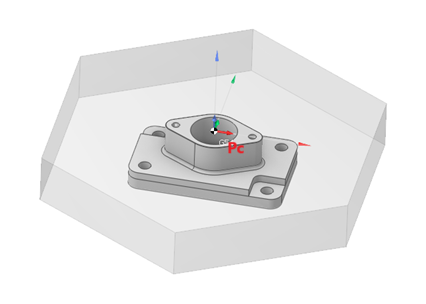

**Turn (Rotieren).** Erzeugt einen Rotationskörper aus den ausgewählten Erzeugendenkurven. Ist keine Kurve ausgewählt, wird ein Dialog zur Kurvenauswahl geöffnet.

Weitere Informationen anzeigen

 

**Extrude (Extrudieren).** Erzeugt ein Prisma.

Weitere Informationen anzeigen

Als Ausgangsobjekte können geschlossene Kurven oder Kurvengruppen verwendet werden, die geschlossene Profile bilden. Sie bestimmen die Grundfläche des Prismas. Zusätzlich werden obere und untere Ebene festgelegt.

Für ein Prisma mit Öffnungen und Inseln legen Sie die Ausgangskurven in einem Ordner ab und verwenden diesen als Prismengrundfläche. Üblicherweise definiert die äußere Kurve den Körper und die inneren Kurven die Öffnungen. Bei Spannmitteln kann die äußere Kurve als Öffnung verwendet werden; aktivieren Sie dazu **Throw hole**.

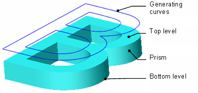

