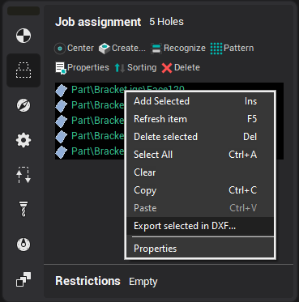

# Hinweise zum Wasserlinien-Schruppen und Taschenfräsen

Bei [Wasserlinien-Schruppen](736.md) und [Taschenfräsen](256.md) definiert die Bohrungsliste bereits gebohrte Positionen, an denen senkrechtes Eintauchen möglich ist. Aktivieren Sie dafür **Through drill point** als Eintauchverfahren. Kann ein Bereich nicht von außen angefahren werden, sucht das System einen geeigneten Punkt in dieser Liste. Wird eine passende Bohrung gefunden, wird sie zum Eintauchen verwendet. Andernfalls wird eine neue Bohrung angelegt und zur Liste hinzugefügt.

Wählen Sie Bohrungen in der Liste und verwenden Sie **Export selected in DXF**, um sie in eine DXF-Datei zu exportieren.

