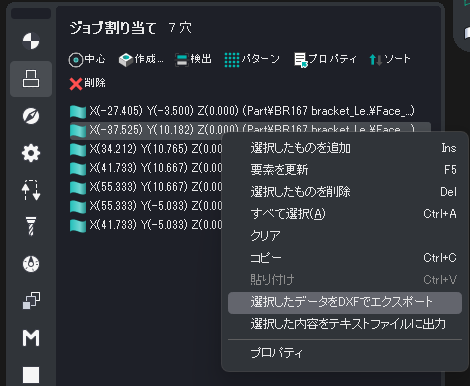

# ウォーターライン荒加工およびポケット加工における裏技

[ウォーターライン荒加工](736.md) および[ポケット加工](256.md)オペレーションでは、穴リストによってあらかじめ穴があけられており工具を垂直に切り込ませる（プランジ）ことができる位置を定義します。これらのオペレーションで穴リストを使用するには、ツールパスウィンドウでプランジ方式を`ドリル点通過`に設定します。ツールパスの計算時に、工具が外側からその領域にアプローチできない場合、システムは穴リストから適切な点を検索し、適切な穴が見つかれば、その穴が工具の垂直プランジに使用されます。適切な穴が見つからない場合は、自動的に穴が作成され、穴リストに追加されます。

工具の切り込み用の下穴加工を行うオペレーションを素早く作成するには、 [穴あけ加工](10100.md)を作成する際に、ユーザーがポケット加工またはウォータライン荒加工をひな形として選択する必要があります。これにより、ひな形加工のすべての穴が、新しく作成したオペレーションにコピーされます。逆に、工具のプランジ用に取得した穴を利用する場合は、そのオペレーションをウォータライン荒加工やポケット加工のひな形として定義することができます。

穴リストから穴を選択し、コンテキストメニューの `選択したデータをDXFにエクスポート`を使用すると、リストをDXFファイルとして出力することができます。

