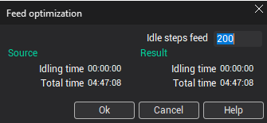

# 送り速度の最適化

シミュレーション後、アイドルノードとしてマークされたノードの送り速度を変更できます。対象のオペレーションを右クリックし、コンテキストメニューから <strong>送り最適化</strong> を選択します。すると、次のダイアログが表示されます。

ウィンドウの左側には、総加工時間とアイドル動作時間が表示されます。右側には、設定した送り速度に基づいて算出された総加工時間およびアイドル時間が表示されます。**OK**をクリックすると、アイドル動作前の送り速度を変更するために、新しい**FEDRATE**コマンドがCLDATAシーケンスに挿入されます。

<em>注意：オペレーションにアイドルステップが含まれていない場合、最適化は効果がありません。また、アイドル動作の送り速度が実際の加工送り速度よりも低い場合、加工時間が増加するため、最適化を行う意味はありません。</em>
