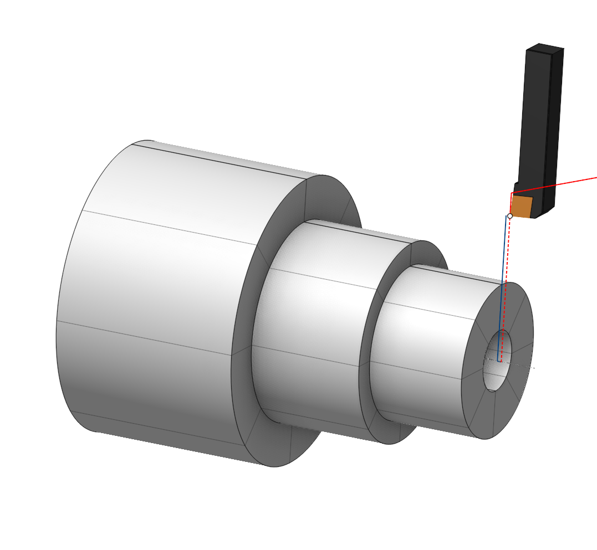

# Faceamento no torno

## Área de aplicação:

A operação foi projetada para preparar a face irregular do bruto (esquerda ou direita). O material é removido pelos movimentos verticais da ferramenta, passada a passada.

### Setup:

A guia <strong>Setup</strong> é usada para configurar os parâmetros primários do projeto. Isso pode envolver o posicionamento da peça no equipamento, o sistema de coordenadas da peça, entre outros. [Detalhes](1022.md)

### Definição da tarefa:

<strong>Facing.</strong> Permite programar a usinagem da face da extremidade de uma peça com um único comando. A trajetória é formada da mesma forma que quando se especificam os ciclos Contour ou Contour Repeat. No entanto, a trajetória é calculada automaticamente com base no bruto e na peça atuais, garantindo a usinagem correta da face da extremidade esquerda ou direita. [Detalhes](10194.md)

<strong>Propriedades.</strong> Exibe as propriedades de um elemento. É possível adicionar sobremetal. Você também pode chamar esse menu clicando duas vezes em um item da lista.

<strong>Excluir.</strong> Remove um item da lista.

<strong>Restrições.</strong> Permite definir as regiões que não devem ser usinadas nesta operação. [Detalhes](101231.md)

### CycleParams:

Esse grupo de parâmetros funciona de forma semelhante às operações OD Roughing e ID Roughing. [Detalhes](316.md)

### Feeds/Speeds:

Esta janela permite definir a rotação do fuso, o avanço rápido e os avanços dos diferentes trechos do percurso. A rotação do fuso pode ser definida em rotações por minuto ou pela velocidade de corte. O valor de referência fica sublinhado; o outro valor é recalculado a partir dele, considerando o diâmetro da ferramenta. [Detalhes](100142.md)

### Transformações:

Conjunto de parâmetros da operação que permite converter as coordenadas do percurso da ferramenta calculado na operação. [Detalhes](10168.md)

### Peça:

A peça é um grupo de elementos geométricos que define a região a ser verificada quanto a cortes indevidos. [Detalhes](330.md)

### Bruto:

O modelo do bruto de uma operação define o material a ser usinado. [Detalhes](738.md)

### Dispositivos de fixação:

Os dispositivos de fixação normalmente incluem mandris, garras, grampos e outros elementos de fixação, além de áreas de restrição de qualquer natureza. [Detalhes](10283.md)
