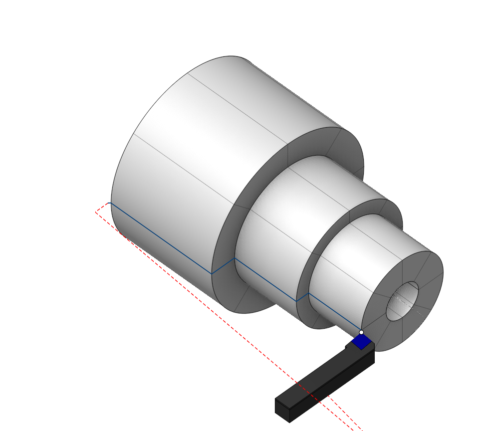
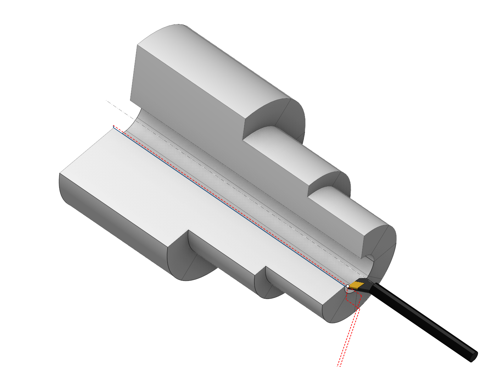

# Außen- und Innenschlichten

 

## Anwendungsbereich:

Diese Operationen entfernen das nach der Vorbearbeitung verbleibende geringe Aufmaß. Die Bearbeitung erfolgt durch versetzte Bahnen entlang der Dreherzeugenden des Bauteils.

### Einrichtung:

Auf **Setup** werden grundlegende Parameter wie Bauteillage und Werkstückkoordinatensystem festgelegt. [Details](1022.md)

### Auftragszuweisung:

**Roughing (Schruppen).** Axialer oder radialer Abtrag entsprechend G71/G72, ausgegeben als Einzelbewegungen. [Details](10192.md)

**Roughing cycle (Schruppzyklus).** Entsprechende Bearbeitung als G71- oder G72-Zyklus. **Direction** wählt zwischen axialer und radialer Bewegungsrichtung. [Details](10193.md)

**Offset Roughing (Konturparalleles Schruppen).** Äquidistante Bahnen zur Kontur entsprechend G73, ausgegeben als Einzelbewegungen. [Details](10190.md)

**Offset cycle (Konturparalleler Zyklus).** Entsprechende Bearbeitung mit Ausgabe als G73. [Details](10191.md)

**Zigzag (Zickzack).** Schichtweise Bearbeitung beidseitig begrenzter Bereiche mit einem neutralen Werkzeug. Nach jeder Zustellung folgt eine horizontale Bahn in Gegenrichtung zur vorherigen Schicht. [Details](10201.md)

**Profile (Profil).** Einzelbahn entlang der Ausgangskontur. Möglich sind An- und Abfahrbewegungen, Aufmaßversatz, das Ausschließen nicht erreichbarer Bereiche und Radiuskorrektur. [Details](10189.md)

**Facing (Plandrehen).** Definiert die linke oder rechte Stirnflächenbearbeitung anhand des aktuellen Rohteils und Bauteils. Die Bahn wird wie bei Profil- oder konturparallelen Zyklen erzeugt. [Details](10194.md)

**Properties (Eigenschaften).** Öffnet die Eigenschaften einschließlich Aufmaßen. Auch ein Doppelklick auf den Listeneintrag öffnet den Dialog.

**Delete (Löschen).** Entfernt den Eintrag.

**Restrictions (Begrenzungen).** Definiert nicht zu bearbeitende Bereiche. [Details](101231.md)

### Zyklusparameter:

Diese Gruppe entspricht den Parametern der Außen- und Innenschruppoperationen. [Details](316.md)

### Vorschübe und Drehzahlen:

Hier werden Spindeldrehzahl, Eilgang und Vorschübe der Bahnabschnitte festgelegt. Die Spindel kann über Drehzahl oder Schnittgeschwindigkeit definiert werden. Der maßgebliche Wert ist unterstrichen; der andere wird anhand des Werkzeugdurchmessers berechnet. [Details](100142.md)

### Transformationen:

Koordinatentransformationen des berechneten Werkzeugwegs. [Details](10168.md)

### Bauteil:

Geometrische Elemente zur Prüfung auf unerwünschte Einschnitte. [Details](330.md)

### Rohteil:

Modell des zu bearbeitenden Materials. [Details](738.md)

### Spannmittel:

Spannfutter, Greifer, Spannpratzen und weitere Befestigungsmittel oder Sperrbereiche. [Details](10283.md)
