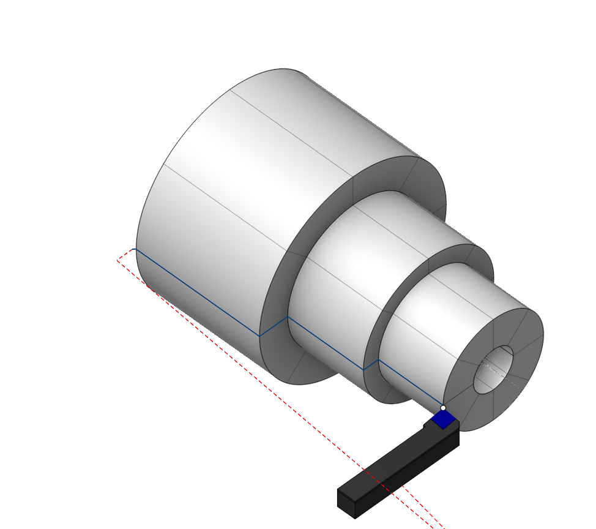
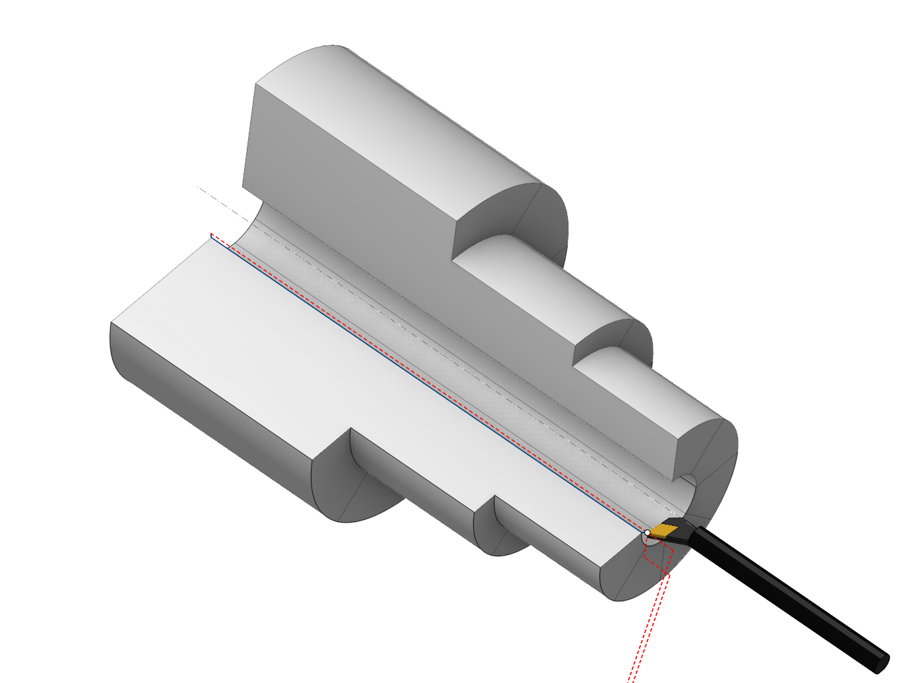

# 外径、内径仕上げ

 

## 適用分野：

旋盤仕上げ加工は、前加工の後に残った少量のストック量を除去するために設計されています。加工は、パーツの母線に対すしてオフセットされた一連のストロークによって実行されます。

## セットアップ：

<strong>セットアップ</strong>タブはプロジェクトの主要なパラメータを設定するために使用します。これには、装置上の部品の位置、部品の座標系などが含まれます。[詳細を見る](https://confluence.encycam.com/display/SC1/.Setup+v19)

## ジョブ割り当て:

<strong>荒取り</strong> 荒取りは、ワークの軸方向（Z軸方向に長いサーフェスを加工する場合）、またはワークの軸に対して垂直な方向（X軸方向に長いサーフェスを加工する場合）への工具の移動によって除去されます。つまり、ISO G71／G72 と同様の軌跡が生成されますが、サイクルは使用せず展開（エクスパンド）された形式で制御プログラムに出力されます。[詳細を見る](10192.md)

<strong>荒取りサイクル</strong> <strong>荒取り</strong>と同様の処理ですが、本オペレーションは ISO G71／G72 と同様のサイクル形式で制御プログラムに出力されます。荒加工サイクルでは、指定されたワークの輪郭に基づいて、ISO G71またはISO G72サイクルのいずれかを作成できます。G71とG72の切り替えは、パラメーター内の <strong>工具方向</strong> を、ワークの軸に沿った方向（ <strong>軸方向</strong> ） 、または軸に対して垂直な方向（ <strong>半径方向</strong> ）に変更することで行います。 [詳細を見る](10193.md)

<strong>荒取りオフセット</strong> 荒取り代は、ワークの輪郭から等距離にある工具の移動によって除去されます。つまり、ISO G73 と同様の軌跡が生成されますが、サイクルは使用せず、展開（エクスパンド）された形式で制御プログラムに出力されます。[詳細を見る](https://confluence.encycam.com/display/SC1/.Offset+Roughing+v18)

<strong>オフセットサイクル</strong> <strong>荒取りオフセット</strong>と同様の処理ですが、本オペレーションは ISO G72 と同様のサイクル形式で制御プログラムに出力されます。[詳細を見る](10191.md)

<strong>ジグザグ</strong> この工程は、ニュートラル工具を使用し、囲まれた領域を両側から加工する際に使用します。工具は下方向へのプランジで切り込み、続いて水平方向に移動して次の層を除去します。その後、工具は再度プランジして切り込み、反対方向に水平方向のパスを行います。このようにして、水平パスを交互の方向に繰り返すことで、荒取り代全体を層ごとに除去します。[詳細を見る](10201.md)

<strong>輪郭</strong> 最も単純なタイプのサイクルで、1 本のパスのみが生成され、その軌跡は指定されたワークの初期形状の幾何輪郭と同一になります。本サイクルで行える輪郭の変更は、アプローチ／退避のリンク付け、指定した仕上げ代によるオフセット、指定工具では到達できないシェード領域の除外、工具半径補正などのわずかな変更のみです。[詳細を見る](https://confluence.encycam.com/display/SC1/.Profile+cycle+v14)

<strong>端面</strong> １つのコマンドでワーク端面の加工プログラムを作成できます。加工軌跡は、〈輪郭加工〉または〈輪郭繰返し〉サイクルを指定する場合と同じ方法で生成されます。ただし、軌跡は現在の素材（ブランク）およびワーク形状に基づいて自動算出され、左端面または右端面のいずれであっても正しく加工されます。[詳細を見る](10194.md)

<strong>プロパティ</strong> 要素のプロパティを表示します。ストックを追加することも可能です。リスト内の項目をダブルクリックして、このメニューを呼び出すこともできます。

<strong>削除</strong> リストから項目を削除します。

<strong>制限</strong> 加工してはならない領域を制限することができます。[詳細を見る](101231.md)

## サイクルパラメータ：

このパラメーターグループは外径、内径荒取りオペレーションと同様に機能します。[詳細を見る](https://confluence.encycam.com/display/SC1/.OD+Roughing+and+ID+Roughing+operations+v19)

## 送り速度設定

このダイアログを使用して、ユーザーは主軸回転速度、早送り値、ツールパスの各領域の送り値を設定できます。主軸回転速度は、毎分回転数または切削速度のいずれかで指定できます。設定値には下線が表示されます。もう一方の値は、工具径を考慮し、設定値に基づいて再計算されます。[詳細を見る](https://confluence.encycam.com/pages/viewpage.action?pageId=137012551)

## 変換：

オペレーション内で計算された工具の軌跡に対して座標変換 を 行うための パラメータグループです 。[詳細を見る](10168.md)

## パーツ：

パーツは、干渉をチェックする空間を定義する幾何要素のグループです。[詳細を見る](330.md)

## ワーク：

加工のワークモデルは、加工する素材を定義します。[詳細を見る](738.md)

## 治具：

治具には通常、チャック、グリップ、クランプなどの固定補助具と、その他の種類の制限領域を指定します。[詳細を見る](10283.md)
