# Canais externos, internos e de face

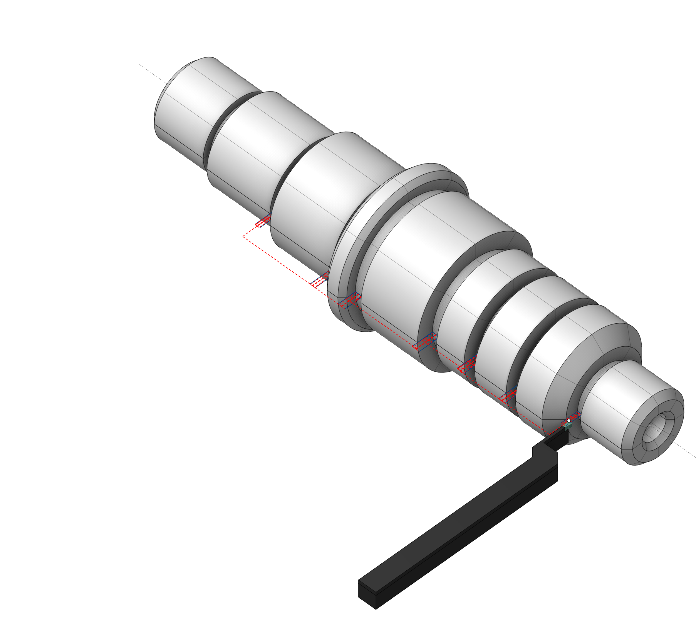

## Área de aplicação:

Essa operação usina ranhuras ou áreas fechadas que são inacessíveis para processamento por outros tipos de operações de torneamento. A usinagem de desbaste consiste em uma sequência de passes perpendiculares ao eixo da peça. Os passes de acabamento são os movimentos que seguem de perto o contorno da peça.

### Setup:

A guia <strong>Setup</strong> é usada para configurar os parâmetros primários do projeto. Isso pode envolver o posicionamento da peça no equipamento, o sistema de coordenadas da peça, entre outros. [Detalhes](1022.md)

### Atribuição de trabalho:

<strong>Ranhuras.</strong> Esse ciclo usina com eficiência ranhuras retangulares simples com um número mínimo de ações. [Detalhes](10196.md)

<strong>Ranhura.</strong> Esse ciclo cria um percurso da ferramenta complexo para o torneamento de todos os tipos de ranhuras e rebaixos. O ciclo identifica o ponto mais baixo da ranhura e processa ambos os lados com diferentes arestas de corte da ferramenta. [Detalhes](10195.md)

<strong>Ziguezague.</strong> A ferramenta remove o sobremetal de desbaste camada por camada. Em cada camada, ela mergulha até a profundidade de corte e executa o movimento horizontal. Assim, os passes horizontais com direções alternadas removem todo o sobremetal, camada por camada. [Detalhes](10201.md)

<strong>Perfil.</strong> O sistema forma uma única passagem, cujo percurso da ferramenta é idêntico ao contorno geométrico da peça. O usuário pode adicionar entrada/saída, deslocamento pelos valores de sobremetal, exclusão das zonas cinzentas inalcançáveis pela ferramenta e compensação do raio da ferramenta no percurso da ferramenta. [Detalhes](10189.md)

<strong>Propriedades.</strong> Exibe as propriedades do elemento selecionado. Além disso, é possível adicionar sobremetal. Para abrir o menu Properties, clique duas vezes no elemento selecionado.

<strong>Excluir.</strong> Remove o item selecionado da lista.

<strong>Restrições.</strong> Permite definir as regiões que não devem ser usinadas. [Detalhes](101231.md)

<strong>Parâmetros do ciclo:</strong>

#### Ciclo:

É possível selecionar um dos ciclos de torneamento disponíveis descritos na atribuição de trabalho. Ao alternar um ciclo nesta seção, o elemento correspondente na atribuição de trabalho muda automaticamente. O conjunto de parâmetros varia para cada ciclo de torneamento.

Clique aqui para expandir...

<strong>Lado usinado.</strong> Especifica os lados da ranhura a serem processados. [Detalhes](10195.md)

Clique aqui para expandir...

<strong>1ª ponta da ferramenta.</strong> O sistema forma o percurso da ferramenta a partir da direção especificada dos passes de desbaste até o lado em que a ferramenta pode tocar com seu primeiro ponto de ajuste.

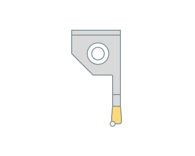

<strong>2ª ponta da ferramenta.</strong> O sistema forma o percurso da ferramenta a partir da direção especificada dos passes de desbaste até o lado em que a ferramenta pode tocar com seu segundo ponto de ajuste.

<strong>Ambas as pontas da ferramenta.</strong> O sistema forma o percurso da ferramenta para usinar os dois lados da ranhura.

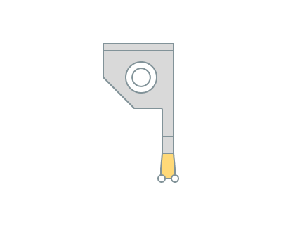

<strong>Percurso da ferramenta.</strong> Esse parâmetro permite escolher para quais passes – <strong>desbaste</strong>, <strong>acabamento</strong> ou <strong>ambos</strong> – o sistema gera o percurso da ferramenta. [Detalhes](10195.md)

Clique aqui para expandir...

<strong>Apenas desbaste.</strong> O sistema gera o percurso da ferramenta somente para a usinagem de desbaste. A janela de parâmetros mostra apenas os parâmetros que afetam esse percurso da ferramenta.

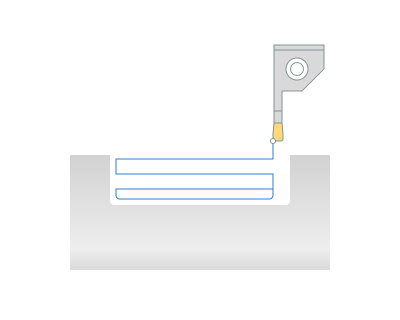

<strong>Apenas acabamento.</strong> O sistema gera o percurso da ferramenta somente para a usinagem de acabamento. A janela de parâmetros mostra apenas os parâmetros que afetam esse percurso da ferramenta.

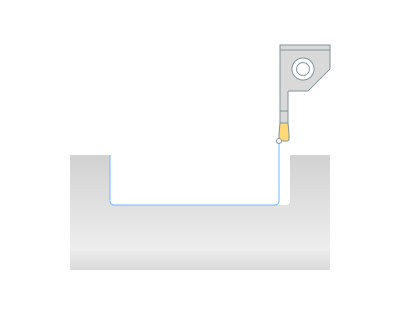

<strong>Desbaste e acabamento.</strong> A mesma ferramenta executa primeiro os passes de desbaste e depois os de acabamento.

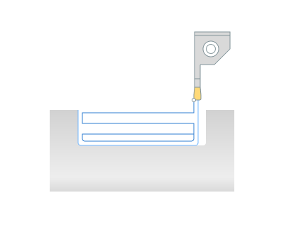

<strong>Direção dos passes de desbaste.</strong> Especifica a direção em que a ferramenta executa os passes durante a usinagem de desbaste da ranhura.

Clique aqui para expandir...

<strong>Do centro.</strong> Os passes de desbaste começam na parte mais profunda da ranhura e se movem para fora, em direção aos lados da ranhura.

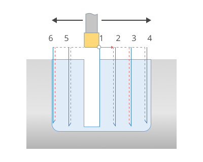

<strong>Para frente.</strong> Os passes de desbaste seguem em uma única direção – do ponto inicial da atribuição de trabalho até o final.

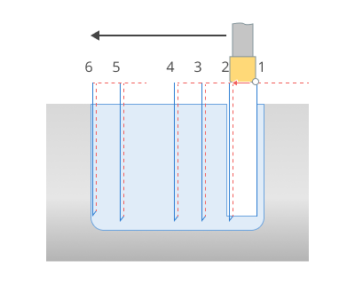

<strong>Passo de desbaste.</strong> A distância entre os passes da ferramenta é igual à profundidade de corte.

Clique aqui para expandir...

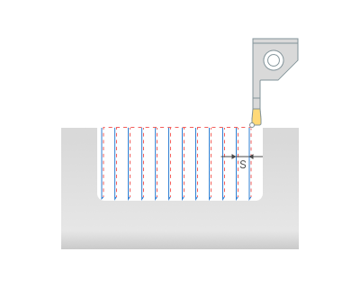

<strong>S -</strong> passo de desbaste

<strong>Ajustar passo.</strong> Quando o sinalizador é definido, o sistema ajusta automaticamente o passo para obter uma força de corte uniforme em cada mergulho.

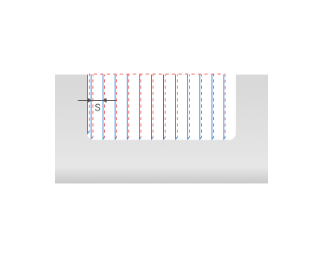 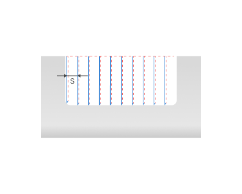

<strong>S -</strong> passo de desbaste

<strong>Desvio máximo do passo.</strong> Define o desvio máximo do passo ajustado em relação ao passo definido. Esse valor pode ser definido em unidades de comprimento ou em porcentagem da largura da ferramenta.

<strong>Sobremetal de desbaste.</strong> Esse parâmetro deixa esse sobremetal para a usinagem subsequente. Se o sinalizador <strong>Finish pass</strong> estiver definido, o sistema removerá esse sobremetal na mesma operação.

Clique aqui para expandir...

<strong>Sobremetal lateral.</strong> Um sobremetal do tamanho especificado aparece nas faces. Em superfícies cônicas e esféricas, o sobremetal diminui de acordo com o ângulo da normal da superfície. Ao definir os sobremetais radial e axial simultaneamente, eles se combinam quadraticamente nessas superfícies.

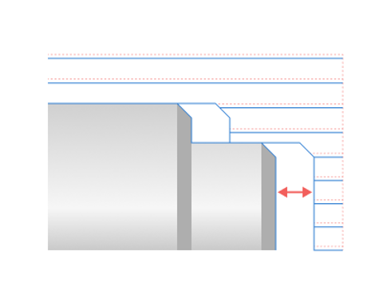

<strong>Sobremetal inferior.</strong> Um sobremetal do tamanho especificado aparece em superfícies cilíndricas. Em superfícies cônicas e esféricas, o sobremetal diminui de acordo com o ângulo da normal da superfície. Ao definir os sobremetais radial e axial simultaneamente, eles se combinam quadraticamente nessas superfícies.

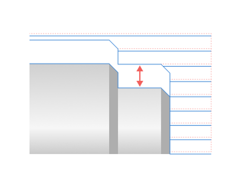

<strong>Perfil.</strong> O percurso da ferramenta com esse sobremetal passa equidistante ao contorno da peça na quantidade especificada. Todos os sobremetais se combinam quando definidos simultaneamente.

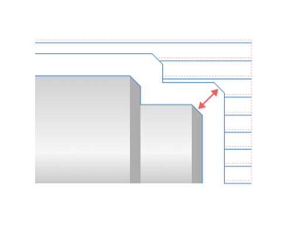

<strong>Direção do passe de acabamento.</strong> Determina a sequência de movimentos durante o passe de acabamento.

Clique aqui para expandir...

<strong>Para o centro.</strong> A ferramenta passa da periferia para o centro durante o acabamento. Ela processa os lados da superfície a ser usinada em traços diferentes.

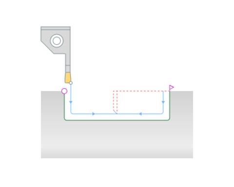

<strong>Para frente.</strong> A ferramenta executa o acabamento de uma só vez, do ponto inicial da atribuição de trabalho até o ponto final.

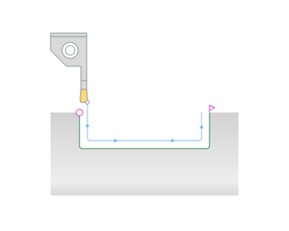

<strong>Para trás.</strong> A ferramenta executa o acabamento de uma só vez, do final da atribuição de trabalho até o ponto inicial.

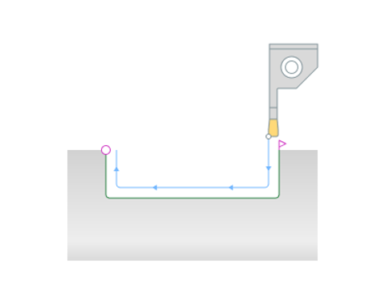

<strong>Ciclo fixo.</strong> Esse parâmetro determina a saída de um ciclo fixo de ranhura no programa NC.

Clique aqui para expandir...

<strong>Não usar.</strong> O percurso da ferramenta não é formatado como um ciclo fixo ISO G75 no programa NC.

<strong>Usar ciclos fixos.</strong> O percurso da ferramenta é formatado como um ciclo fixo ISO G75 no programa NC.

<strong>Primeiro corte separado.</strong> O primeiro passe da ferramenta é formatado como um ciclo fixo ISO G75 separado, enquanto os passes subsequentes são formatados como um segundo ciclo fixo ISO G75 separado.

<strong>Cada corte separado.</strong> Cada passe da ferramenta é formatado como um ciclo fixo ISO G75 separado.

<strong>Multicamadas.</strong> Essa técnica facilita a remoção do material de desbaste em várias camadas. Após a ativação do sinalizador, a ferramenta faz passes cruzados para remover a primeira camada, passa para a segunda camada e assim por diante.

Clique aqui para expandir...

<strong>Tipo de retorno.</strong> Especifica o nível de elevação da ferramenta durante os movimentos ociosos entre camadas em uma mesma ranhura. O parâmetro <strong>Safe Distance</strong> define esse nível.

<strong>Contagem.</strong> Especifica diretamente o número de camadas em que a profundidade da ranhura é dividida.

<strong>Sobreposição.</strong> O sistema realiza cortes de semiacabamento para remover as cristas remanescentes após os passes de desbaste. [Detalhes](10195.md)

Clique aqui para expandir...

<strong>Ligado.</strong> Quando o sinalizador é definido, o sistema executa um passe de semiacabamento para remover as cristas remanescentes após os passes de desbaste.

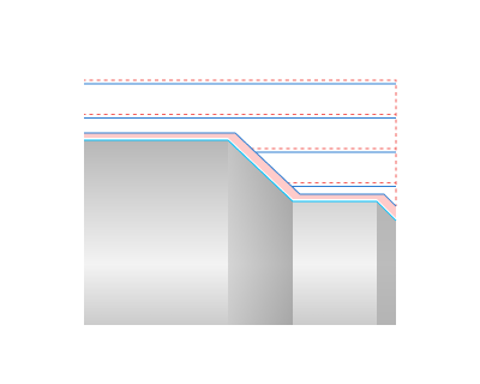

<strong>Desligado.</strong> O percurso adicional da ferramenta não é gerado.

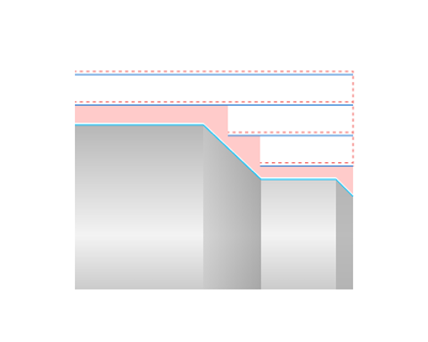

<strong>Auto.</strong> No modo Auto, a opção Sobreposição é ativada quando a opção Multicamadas está ativada.

<strong>Quebra de cavaco.</strong> O sistema controla o modo de quebra cinemática de cavacos no qual, após um comprimento de corte especificado, a ferramenta se retrai para interromper a formação de cavacos contínuos. Em seguida, a ferramenta entra novamente no material e continua cortando.

Clique aqui para expandir...

<strong>Desligado.</strong> O modo de quebra de cavaco é desativado.

<strong>No primeiro mergulho.</strong> O sistema ativa o modo de quebra cinemática de cavacos somente durante o primeiro passe de desbaste de cada camada de usinagem.

<strong>Contagem de interrupções.</strong> Especifica diretamente o número de paradas da ferramenta.

<strong>Retorno (% do mergulho).</strong> Especifica a distância de retorno da ferramenta após a parada para quebra de cavacos como porcentagem de <strong>Step Depth</strong>.

<strong>Em cada mergulho.</strong> O sistema ativa o modo de quebra cinemática de cavacos em cada passe de desbaste.

<strong>Atraso no fundo.</strong> Esse recurso controla a parada do avanço no fundo da ranhura para obter um fundo uniforme. A ativação desse recurso introduz uma duração de parada.

<strong>Recuo.</strong> O sistema afasta a ferramenta da superfície processada ao se retrair após os cortes de desbaste, puxando a ferramenta para o lado; a distância de retração é medida perpendicularmente à direção do corte.

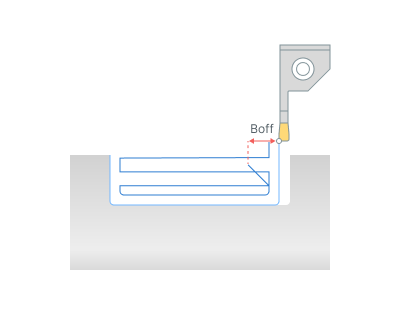

<strong>Distância segura.</strong> A distância do nível superior da ranhura até o nível dos movimentos rápidos. É possível editar a distância de segurança arrastando um ponto na tela gráfica ou inserindo o valor diretamente na janela de opções.

.png)

<strong>Verificar bruto.</strong> Quando o sinalizador é definido, o sistema leva em conta o estado atual do bruto. Isso reduz significativamente o tempo de usinagem, especialmente se a forma do sobremetal for complexa. O grupo de parâmetros funciona de forma semelhante às operações <strong>OD Roughing e ID Roughing.</strong> [Detalhes](316.md)

<strong>Compensação:</strong> Esse parâmetro controla o método de saída da compensação da largura da ferramenta.

Clique aqui para expandir...

<strong>Desligado.</strong> O sistema não leva em conta a largura do inserto e envia o percurso da ferramenta para o programa NC sem transformações geométricas. Ao usar esse modo em contornos complexos, podem ocorrer rebaixos ou usinagem incompleta; por isso, é necessário verificar cuidadosamente a simulação de usinagem.

<strong>Computador.</strong> O sistema leva em conta a largura e o raio da ponta do inserto e cria o percurso da ferramenta de acordo com o primeiro ponto de ajuste da ferramenta.

<strong>Usar o 2º corretor.</strong> A usinagem do lado direito da ranhura usa o segundo ponto de ajuste. Todos os outros passes usam o primeiro ponto de ajuste.

#### Arredondar com arcos.

O sistema arredonda os cantos externos do percurso da ferramenta com arcos de raio igual ao raio da ponta da ferramenta. O grupo de parâmetros funciona de forma semelhante às operações <strong>OD Roughing e ID Roughing.</strong> [Detalhes](316.md)

### Avanços e velocidades:

Esta janela permite definir a rotação do fuso, o avanço rápido e os avanços dos diferentes trechos do percurso. A rotação do fuso pode ser definida em rotações por minuto ou pela velocidade de corte. O valor de referência fica sublinhado; o outro valor é recalculado a partir dele, considerando o diâmetro da ferramenta. [Detalhes](100142.md)

### Transformações:

Conjunto de parâmetros da operação que permite converter as coordenadas do percurso da ferramenta calculado na operação. [Detalhes](10168.md)

### Peça:

A peça é um grupo de elementos geométricos que define a região a ser verificada quanto a cortes indevidos. [Detalhes](330.md)

### Bruto:

O modelo do bruto de uma operação define o material a ser usinado. [Detalhes](738.md)

### Dispositivos de fixação:

Os dispositivos de fixação normalmente incluem mandris, garras, grampos e outros elementos de fixação, além de áreas de restrição de qualquer natureza. [Detalhes](10283.md)
